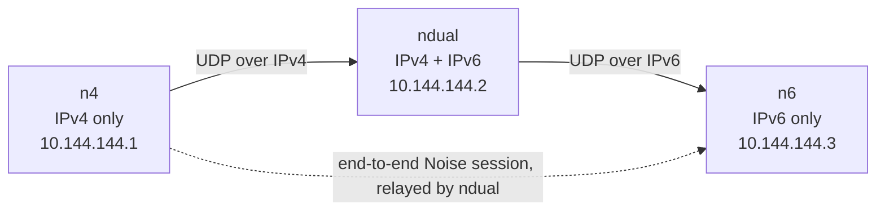

# Skein

[](https://github.com/Utsav-X-bit/Skein/actions/workflows/ci.yml)

Skein is a small userspace mesh VPN for 2–5 of your own machines on Linux and
Windows. It builds an encrypted full mesh over plain UDP and can bridge an
IPv4-only host to an IPv6-only host when a dual-stack member is online.



`ndual` forwards opaque ciphertext: it never holds the `n4 ↔ n6` session keys.

## Features

- **End-to-end `Noise_IKpsk2_25519_ChaChaPoly_BLAKE2s`** between every pair of
  nodes, with explicit nonces, 64-packet replay windows per key epoch, and a
  fresh rekey every hour or 2³² packets.
- **Dual overlay**: IPv4 `10.144.144.0/24` and IPv6 ULA `fd00:6d65:7368::/64`,
  both configurable per node.
- **One UDP port** (default `11010`), dual-stack socket with a paired-socket
  fallback.
- **Discovery**: static peers, `skein:1:…` invite strings, mDNS on the local
  link, and authenticated state gossip carrying overlay addresses, names, and
  self-certifying public keys, so a mesh forms without every pair exchanging
  invites.
- **Bounded routing**: distance vector with full paths, split horizon, and at
  most four links. Relays rewrite only `to_next` and `ttl`.
- **One CLI binary**: `skein` runs the daemon (`skein run`), the system
  service, the TUI dashboard, and every client command; `skeind` remains a
  thin wrapper.
- **Desktop control surface**: `skein-desktop` is a Wails app for onboarding,
  peers, invites, activity, diagnostics, settings, firewall repair, and
  service control. It talks to the daemon over a root-owned Unix socket or
  Windows named pipe, never a shell.
- **Fixed-verb privileged helper**: `skein-helper` performs init/join/import,
  service changes, secret rotation, resets, and signed updates. Every verb
  validates its inputs and returns one JSON object; secrets travel on stdin or
  a GUI-created pipe, never argv.
- **Automatic firewall**: `skein run` opens the underlay port and trusts the
  overlay interface (ufw, firewalld, raw iptables fallback, or Windows
  Firewall), so any protocol works without extra rules. The desktop Security
  page shows the manager, owned rules, and a repair action.
- **Relay introductions**: a peer reachable only through a relay asks it for an
  introduction, both sides dial each other's observed endpoint at once, and a
  failed punch keeps the relayed path.
- **TCP fallback**: every node listens on TCP on the same port; after two
  silent UDP attempts the dialer switches to TCP.
- **Self-maintaining config**: learned peers are written back to the TOML
  atomically, so a restart keeps the mesh.
- **Named nodes**: each node sets `node.name`; names travel in STATE gossip and
  appear in the dashboard, `skein peers`, and the API.
- **Mission-control dashboard**: `skein dashboard` adapts from compact to wide
  terminals, renders only known route paths, and shows per-link throughput,
  transport, RTT, jitter, and authenticated aggregate mesh activity.

## Status

| Area | Verified |
|---|---|
| Unit tests, `-race`, fuzz target | pass |
| Loopback UDP handshake + overlay packet | pass |
| Three-node Linux netns bridge (v4-only ↔ v6-only) | pass |
| mDNS discovery across a veth | pass (2 s to `up`) |
| systemd install / start / stop / uninstall | pass |
| TUN kernel round-trip | pass |
| Relay introductions (punch) | unit tests (control relay + dataplane) |
| TCP fallback over loopback | pass |
| Firewall automation (ufw) | verified live; iptables fallback covered by unit tests |
| Desktop onboarding, service control, security, firewall repair | verified live on Linux |
| Desktop build (`wails3 build`) | verified on Linux; Windows build scripted |
| Windows | cross-compiles; runtime smoke script provided, not yet run in a VM |

Version `0.1.0-dev`.

## Install

### Linux

Build the CLI, the fixed-verb helper, and the desktop app:

```bash
git clone https://github.com/Utsav-X-bit/Skein && cd Skein
go build -trimpath -o skein ./cmd/skein
go build -trimpath -o skein-helper ./cmd/skein-helper

cd gui
wails3 build          # -> gui/bin/skein-desktop
cd ..

sudo install -m 0755 skein /usr/local/bin/skein
sudo install -m 0755 skein-helper /usr/libexec/skein-helper
sudo install -m 0755 gui/bin/skein-desktop /usr/local/bin/skein-desktop
```

The desktop build needs the Wails 3 CLI and the GTK4/WebKitGTK 6.0
development packages. `wails3 doctor` reports missing dependencies. The helper
must stay root-owned at `/usr/libexec/skein-helper`.

Start the desktop app as your normal user:

```bash
skein-desktop
```

First run offers **Create a network**, **Join a network**, or **Use an
existing installation**. The desktop uses `pkexec` to run the helper, which
writes the root-owned config to `/etc/skein`, installs `skein.service`, starts
it, and grants your uid access to `/run/skein/control.sock`. The TUI and CLI
then attach to that service without `-c`:

```bash
skein status
skein dashboard
```

The CLI-only path remains available for development:

```bash
skein init                       # user-owned config; no root needed
sudo skein run -c ~/.config/skein/skein.toml
```

For a service install without the desktop:

```bash
sudo skein install-service -c /home/$USER/.config/skein/skein.toml
sudo systemctl enable --now skein
```

`install-service` opens the underlay UDP port for **IPv4 and IPv6** before the
service starts; the overlay interface trust rule is added when the daemon
starts. ufw and firewalld both get family-neutral rules, so one rule covers
both stacks; without either, Skein appends its own iptables rules. The TUN
interface, addresses, routes, and MTU are configured by the daemon.

### Windows

1. Build the CLI, helper, and desktop app:

   ```powershell
   git clone https://github.com/Utsav-X-bit/Skein
   cd Skein
   go build -trimpath -o dist\skein.exe        .\cmd\skein
   go build -trimpath -o dist\skeind.exe       .\cmd\skeind
   go build -trimpath -o dist\skein-helper.exe .\cmd\skein-helper

   cd gui
   wails3 build          # -> gui\bin\skein-desktop.exe
   cd ..

   .\scripts\fetch-wintun.cmd -Dest dist
   ```

   `fetch-wintun.cmd` runs the PowerShell fetcher with `-ExecutionPolicy
   Bypass`, downloads the pinned Wintun release, verifies its SHA-256, and
   installs `wintun.dll` plus its license. If scripts are blocked entirely:

   ```powershell
   powershell -NoProfile -ExecutionPolicy Bypass -File .\scripts\fetch-wintun.ps1 -Dest dist
   ```

   or download <https://www.wintun.net/builds/wintun-0.14.1.zip> manually and
   copy `wintun/bin/amd64/wintun.dll` into `dist`.

2. Install the desktop bundle. The GUI expects the helper at its default
   location:

   ```powershell
   New-Item -ItemType Directory -Force 'C:\Program Files\Skein' | Out-Null
   Copy-Item dist\skein-helper.exe 'C:\Program Files\Skein\skein-helper.exe'
   Copy-Item gui\bin\skein-desktop.exe dist\
   ```

   `wintun.dll` must sit next to every executable that creates the tunnel and
   match its architecture.

3. Start `dist\skein-desktop.exe` as your normal user. First run offers
   **Create a network**, **Join a network**, or **Use an existing
   installation**; UAC elevates the helper, which writes
   `C:\ProgramData\Skein\skein.toml`, installs the `skein` service, and
   starts it. The desktop then talks to the daemon over
   `\\.\pipe\skein-control`.

4. The CLI-only path is still available for development:

   ```powershell
   .\skein.exe init
   .\skein.exe run -c "$env:APPDATA\skein\skein.toml"      # elevated
   .\skein.exe status
   .\skein.exe peers list
   ```

5. Service install without the desktop:

   ```powershell
   .\skein.exe install-service -c "$env:APPDATA\skein\skein.toml"
   sc start skein
   ```

`install-service` creates the underlay UDP rule (both address families)
immediately; the overlay interface rules (inbound and outbound) are created
when the daemon starts. The desktop Security page can repair them.

### Windows with Git Bash

Everything works from Git Bash; the differences are elevation and the terminal.

```bash
git clone https://github.com/Utsav-X-bit/Skein && cd Skein
go build -trimpath -o dist/skein.exe        ./cmd/skein
go build -trimpath -o dist/skeind.exe       ./cmd/skeind
go build -trimpath -o dist/skein-helper.exe ./cmd/skein-helper

# fetch wintun (bypasses the PowerShell execution policy)
./scripts/fetch-wintun.cmd -Dest dist
```

If the wrapper is blocked too:

```bash
powershell -NoProfile -ExecutionPolicy Bypass -File ./scripts/fetch-wintun.ps1 -Dest dist
```

Confirm the DLL sits next to the binaries:

```bash
ls -l dist/wintun.dll
```

The dev CLI config lives in `%APPDATA%\skein\skein.toml`, which Git Bash
exposes as `$APPDATA/skein/skein.toml`. The desktop/service config lives in
`C:\ProgramData\Skein\skein.toml` and is root/Administrator-owned:

```bash
./dist/skein.exe init
./dist/skein.exe status
./dist/skein.exe peers list
./dist/skein.exe -c "$APPDATA/skein/skein.toml" dashboard
```

- `sudo` does not exist in Git Bash. Start it with **Run as administrator**
  for `run`, `install-service`, and `dashboard` when they need to start the
  daemon.
- MinTTY is not a Windows console, so the dashboard falls back to the static
  snapshot there. For the animated TUI use `winpty` or a Windows Terminal /
  PowerShell tab:

  ```bash
  winpty ./dist/skein.exe dashboard
  ```

- If the dashboard is not elevated it prints the exact command to run from an
  elevated prompt instead of starting a daemon it cannot create. With the
  desktop service installed, `skein status` and `skein dashboard` attach to
  `\\.\pipe\skein-control` without `-c`.
- `scripts/fetch-wintun.sh` also works in Git Bash when `unzip` is installed;
  the `.cmd` wrapper needs no extra tools.


## Quick start

**First node** (no privileges needed):

```bash
./skein init          # identity, config, secret, API token, and a join string
```

It prints a `join:` line like `skein:2:…`. That one string carries the network
secret, the inviter's identity and addresses, the overlay prefixes, and the
overlay addresses already in use. Treat it as a secret.

**Every other node**:

```bash
./skein join "skein:2:…"   # sets the secret, a free overlay address, and the inviter as a peer
```

`join` writes the config and, if needed, a fresh identity. Start both ends:

```bash
sudo ./skein run -c ~/.config/skein/skein.toml
```

The inviter accepts the joiner automatically once the joiner proves the network
secret during the handshake; no peer block is needed on the inviter. Static
peers remain supported when you want fixed addresses:

```toml
[[peer]]
id     = "b3f64ecc491aba35"
pubkey = "K2Ipr1k0juOQxvsbrOFvFo2vMupEJjP78aIA1VytR2U="
dialer = true                      # exactly one side of each pair
addrs  = ["udp://203.0.113.5:11010"]
```

Start the daemon as root/Administrator and check it as your normal user:

```bash
sudo ./skein run -c ~/.config/skein/skein.toml      # the shell expands ~ first
./skein status
./skein peers list
./skein routes
./skein ping 10.144.144.2
```

Service mode:

```bash
sudo ./skein install-service -c ~/.config/skein/skein.toml   # systemd / Windows SCM
```

`skeind` remains available as a thin wrapper with the same `run`,
`install-service`, and `uninstall-service` commands.

## Dashboard

```bash
./skein dashboard
```

With the desktop service installed, the dashboard attaches to
`/run/skein/control.sock` on Linux or `\\.\pipe\skein-control` on Windows;
no `-c` is needed. A stale per-user config no longer hides the service: the
default-path client prefers the system control plane, while an explicit `-c`
still selects a dev daemon.

If no daemon is answering, the dashboard starts one from the selected config
(and stops it when you quit). Under `sudo` the invoking user's config is used.
Daemon output from a dashboard-started daemon goes to `<config>.log`.

The full-screen dashboard is a dense, btop-style network console. It uses a
woven Skein infinity mark derived from `Logo.png` and reflows for compact,
standard, wide, and short terminals. Its route map draws direct links and
resolved relay paths; it does not invent peer-to-peer edges. Link motion
appears only for measured local traffic or fresh, authenticated aggregate mesh
activity.

`Tab` (or `h`/`l`) changes panels; arrow keys (or `j`/`k`) select a peer;
`Enter` opens its inspector; `Space` pauses decorative/activity motion; `?`
opens the key reference; and `q` quits. The inspector reports current RX/TX
speed and peak (byte-counter deltas), current/rolling RTT, jitter (the change
between RTT samples), transport, hop/direct status, and freshness.

Mesh activity gossip contains only bounded aggregate byte deltas, link
performance, peer IDs, and route IDs—never packet contents, overlay addresses,
ports, or flow identifiers. Remote samples expire quickly and are labelled as
stale rather than extrapolated. `--no-motion` (or `SKEIN_NO_MOTION=1`) renders
a static snapshot; non-TTY output is always static. Set `SKEIN_ASCII=1` for an
ASCII version of the Skein mark on terminals without reliable Unicode.

## Naming nodes

```bash
./skein name "utsav-laptop"     # show or set this node's name
```

The name is advertised in STATE gossip, so every peer displays it instead of a
peer ID. A peer can also be given a local hint before first contact:

```toml
[[peer]]
id     = "b3f64ecc491aba35"
name   = "yoga"
pubkey = "…"
```

The name a peer advertises about itself always wins over the local hint.

## Configuration

```toml
[node]
overlay_ipv4_prefix = "10.144.144.0/24"
overlay_ipv6_prefix = "fd00:6d65:7368::/64"
overlay_ipv4        = "10.144.144.2"
overlay_ipv6        = "fd00:6d65:7368::2"   # optional; requires mtu >= 1280
listen_port         = 11010
network_secret      = "<32 random bytes, base64url>"
mtu                 = 1280
interface           = "skein0"              # Windows default: Skein
name                = "utsav-laptop"        # optional, shown to peers (default: hostname)
public_addr         = "203.0.113.7:11010"   # optional: only when the external port differs

[api]
socket = "/run/skein/control.sock"          # Linux service; helper-managed
# pipe = "skein-control"                    # Windows service
listen = "127.0.0.1:11011"                  # dev-only loopback listener
token  = "<32 random bytes, base64url>"     # dev-only bearer token

[discovery]
mdns        = true
stun        = true                           # learn and advertise the public IPv4/IPv6
stun_server = "stun.l.google.com:19302"      # optional override
```

The desktop/service config is `/etc/skein/skein.toml` on Linux and
`C:\ProgramData\Skein\skein.toml` on Windows, root/Administrator-owned; the
helper writes `api.socket` or `api.pipe` and disables the dev TCP listener.
`api.listen` + `api.token` are for a user-run dev daemon only. The system
socket is `0660 root-owned` with a per-uid ACL; the Windows pipe DACL grants
SYSTEM, Administrators, and the chosen user.

Unknown keys are rejected. The daemon refuses a config readable by group or
others, and the X25519 key lives in `<config dir>/identity.key` with owner-only
permissions.

Full key-by-key reference: [`docs/protocol.md`](docs/protocol.md#configuration).

## CLI

| Command | Purpose |
|---|---|
| `skein init` | Dev-only: create a user-owned identity, config, network secret, API token |
| `skein run` | Run the daemon (root / Administrator); the service uses `/etc/skein` |
| `skein reset [--purge] [--keep-identity]` | Leave the mesh: back up or remove the config and identity, then re-init or join |
| `skein setup [--remove]` | Allow UDP `listen_port` and all traffic on the overlay interface (ufw, firewalld, iptables, Windows Firewall) |
| `skein install-service` | Register the system service |
| `skein uninstall-service` | Remove the service and its firewall rules |
| `skein genkey` | Print the public key and node ID |
| `skein invite` | Print `skein:1:<base64url>` (identity + addresses, no secret) |
| `skein invite --network` | Print the `skein:2:` join string (contains the secret) |
| `skein join <invite>` | Configure this node from a network invite |
| `skein name [value]` | Show or set this node's name |
| `skein dashboard` | Live TUI; attaches to the service socket/pipe or starts a dev daemon |
| `skein status [--json]` | Overlay addresses, peers, uptime, counters |
| `skein peers [list\|add\|rm]` | Manage peers |
| `skein routes [--json]` | Reachability table |
| `skein probe <peer-id>` | Re-probe candidate endpoints |
| `skein ping <overlay-ip>` | Ping through the overlay |
| `skein version`, `skein -v` | Version plus the commit the binary was built from |

`setup`, `install-service`, `uninstall-service`, and `reset` are also available
through `skein-helper` with fixed arguments; the desktop uses the helper so no
shell is involved. Helper verbs: `init`, `join`, `import`, `install`,
`uninstall`, `start`, `stop`, `restart`, `status`, `rotate-secret`, `reset`,
`grant-user`, `set-owner`, `update-daemon`.

### Global flags

| Flag | Meaning |
|---|---|
| `-c, --config <path>` | Explicit config. Without it, client commands prefer the installed service control plane; otherwise the user config dir is used. |
| `--json` | Machine-readable output for `status`, `peers`, `routes`. |
| `--no-color` | Disable ANSI colour. |
| `--no-motion` | Static dashboard (same as `SKEIN_NO_MOTION=1`). |

### Environment

| Variable | Meaning |
|---|---|
| `SKEIN_NO_MOTION=1` | Render the dashboard as a static snapshot. |
| `SKEIN_ASCII=1` | ASCII Skein mark for terminals without reliable Unicode. |
| `SKEIN_NO_TRAY=1` | Start the desktop without a tray icon (diagnostics). |
| `SKEIN_HELPER` | Override the helper path (desktop/development). |
| `SKEIN_DEBUG=1` | Per-frame receive/forward/drop diagnostics on the daemon. |
| `SKEIN_TUN_PROBE=1` | Root-only TUN kernel round-trip test. |
| `SKEIN_NETNS_PREFIX` | Namespace prefix used by `test/netns/run.sh`. |

Exit codes: `0` success, `1` runtime or API error, `2` usage error.

## API

The desktop and CLI use the same JSON API over the service control plane:

- **Linux**: `unix:///run/skein/control.sock`, `0660 root-owned` plus a per-uid
  ACL; the daemon authenticates the caller with `SO_PEERCRED`.
- **Windows**: `\\.\pipe\skein-control`, DACL SYSTEM/Administrators/granted
  user; the server impersonates the client and checks the token SID.
- **Dev TCP**: `api.listen` + `Authorization: Bearer <token>`; loopback only,
  browser `Origin` requests rejected, no CORS headers.

Body limit 16 KiB, strict JSON, unknown fields rejected. Mutations are audited
without secrets and rate-limited per caller. Errors use
`{code,message,remediation,details,request_id}`.

| Method | Path |
|---|---|
| `GET` | `/api/v1/capabilities` |
| `GET` | `/api/v1/status` |
| `GET` | `/api/v1/identity` |
| `GET` / `PATCH` | `/api/v1/config` (secrets redacted; patch allowlist) |
| `POST` | `/api/v1/connection` (`connect` / `disconnect`) |
| `GET` / `POST` | `/api/v1/peers` |
| `DELETE` | `/api/v1/peers/{id}` |
| `POST` | `/api/v1/peers/{id}/probe` |
| `GET` | `/api/v1/routes` |
| `GET` | `/api/v1/activities` |
| `POST` | `/api/v1/invites/peer`, `/api/v1/invites/network` |
| `GET` | `/api/v1/logs?since=&limit=` |
| `GET` | `/api/v1/events` (SSE; `Last-Event-ID` replay) |
| `GET` | `/api/v1/diagnostics` |
| `GET` | `/api/v1/security` |
| `GET` | `/api/v1/firewall` |
| `POST` | `/api/v1/firewall/repair` |

Full contract: [`docs/gui-api.md`](docs/gui-api.md).

## Firewall and any protocol

`skein run` opens what it needs at startup, idempotently:

- **Linux** — with `ufw` active it allows `<port>/udp`, all traffic on the
  overlay interface, and the matching route rules; with `firewalld` it adds the
  port and puts the interface in the trusted zone; otherwise it appends
  `INPUT`/`OUTPUT`/`FORWARD` accepts for the interface and underlay port.
- **Windows** — it creates `Skein underlay` (inbound UDP on the port),
  `Skein overlay` (all inbound traffic on the interface), and `Skein overlay
  out` (all outbound traffic on the interface) firewall rules.

The desktop Security page reports the detected manager, the owned rule set,
config/identity ownership and modes, socket ACL, update signature, and a
**Repair rules** action. “5 managed” is the expected set, not a live audit of
every kernel rule. A systemd sandbox must allow `/run/ufw.lock` for `ufw status`
to work; the shipped unit does.

Because the overlay interface is trusted, every protocol works without
per-service rules:

```bash
ssh user@10.144.144.2
python3 -m http.server 8000 --bind 10.144.144.1
```

The only underlay requirement is that **one side of each pair is reachable** on
the UDP port: a public IPv4 with a forward, a public IPv6, or the same LAN.
SSH and every other protocol travel inside the tunnel and never need their own
router forward.

## Reliability

- Keepalive every 15 s keeps NAT mappings open.
- 45 s without authenticated traffic marks the peer down, clears the cached
  endpoint, drops the session, and withdraws its routes; a configured dialer
  re-handshakes immediately instead of encrypting for a dead address.
- Handshake retries back off 1 s → 30 s and reset as soon as a route appears.
- A changed endpoint is only adopted after a challenge/response over the
  existing session.
- When a path dies, the session is dropped and the dialer retries UDP, then TCP
  on the same port, then the relayed route.

## Reaching peers behind NAT

One side of every pair must be reachable, or introduced by a relay:

- **Direct** — a public IPv4 with a UDP forward, a public IPv6, or the same LAN.
  A node probes a STUN server over both families (`discovery.stun`) and
  advertises the public IPv4 and IPv6 next to its LAN addresses, so joiners
  dial the right place without editing configs. Set `node.public_addr` when
  the external port differs from `listen_port`, or `stun = false` to disable
  the probes (the `SKEIN_NO_STUN` environment variable does the same).
- **Relayed** — both sides connect to any reachable peer (a cheap VPS is
  enough); it forwards opaque ciphertext.
- **Introductions** — a node that only reaches a peer through a relay asks the
  relay, which reports both observed endpoints; both sides dial at once. This
  works for endpoint-independent NAT; symmetric NAT keeps the relayed path.
- **UDP blocked** — after two silent UDP attempts the dialer opens TCP to the
  same port, and TCP frames are written in one syscall with Nagle disabled so
  the fallback does not collapse under delayed ACKs. A datagram from the peer
  clears the preference again, so a working UDP path always wins. Set
  `listen_port = 443` to make both transports use 443.

### Examples

| A | B | C | Result |
|---|---|---|---|
| CGNAT v4 + public v6 | CGNAT v4 + public v6 | public v4 | A↔B **direct over IPv6**; A↔C and B↔C direct if C has IPv6, otherwise relayed through whichever node does |
| CGNAT v4 + public v6 | public v4 + public v6 | CGNAT v4 | A↔B direct over IPv6; C dials B over IPv4; A↔C relayed through B |
| CGNAT v4 + public v6 | public v4 + public v6 | CGNAT v4 + no v6 | same, with C dialing B and B forwarding |

Candidates include every interface address (v4 and v6), so the dialer tries
IPv6 first when it works; the route table then keeps the cheapest validated
path. IPv6 needs UDP `<port>` open on the listener's host firewall, which the
daemon configures automatically.

Not implemented: TLS camouflage and a global DERP-style relay network. STUN
is implemented (`discovery.stun`); the probes learn the public IPv4/IPv6.

## How it works

```
[type:1][to_next:8][to_final:8][from:8][ttl:1] payload
```

The 26-byte header is authenticated as AEAD associated data except the
relay-mutable `to_next` and `ttl`. Encrypted frames add `[epoch:4][counter:8]`
and a 16-byte tag, so a 1280-byte inner packet becomes **1382 bytes over IPv6**
or **1362 bytes over IPv4** — 54 bytes of protocol overhead.

Handshakes are Noise IKpsk2 with a 128-bit attempt ID and the epoch bound into
the prologue. A session is installed only after an encrypted confirmation; at
one epoch the smaller attempt ID wins, and higher epochs always supersede.
Relays forward both handshake messages and opaque data.

Peer down after 45 s of silence, keepalive every 15 s, state sync every 5 s,
handshake backoff 1→30 s.

## Limits

- Two symmetric-NAT peers still need a reachable relay peer; there is no
  global relay network.
- The TCP fallback is plain TCP, not TLS; it defeats UDP blocking but not
  deep-packet inspection.
- IPv4-only ↔ IPv6-only needs a dual-stack member; no common family, no path.
- More than five nodes or routes longer than four links are unsupported.
- No PMTUD or fragmentation; a dual-stack underlay path below 1382 bytes of
  PMTU is unsupported.
- One shared secret, no per-peer ACLs or revocation. The join string contains
  that secret, so anyone holding it can join the network.
- The control API authenticates the caller, but every process running as a
  granted uid can use it; relays can observe peer IDs, sizes, and timing.

## Testing

```bash
go test -race ./...
(cd gui && wails3 build)                            # desktop compile
sudo -E env "PATH=$PATH" ./test/netns/run.sh        # v4-only ↔ v6-only bridge
SKEIN_TUN_PROBE=1 sudo -E env "PATH=$PATH" \
  go test ./internal/tun -run TestTUNWriteRead -v    # TUN kernel round-trip
```

TUI smoke: `skein dashboard` with the service running should attach over the
socket/pipe and quit with `q`. Windows runtime check:
`test/windows/smoke.ps1` (elevated, with `wintun.dll`).

## Docs

- [`docs/protocol.md`](docs/protocol.md) — wire format, handshake, routing,
  discovery, configuration.
- [`docs/measurements.md`](docs/measurements.md) — what was measured and how to
  reproduce it.
- [`docs/gui-api.md`](docs/gui-api.md) — desktop/daemon API contract.
- [`docs/superpowers/specs/`](docs/superpowers/specs) — design spec.
- [`docs/superpowers/plans/`](docs/superpowers/plans) — implementation plan.

## Layout

```
cmd/skein                 daemon, TUI dashboard, and CLI in one binary
cmd/skeind                thin daemon wrapper
cmd/skein-helper          fixed-verb elevated helper for the desktop
gui/                      Wails desktop app, services, frontend, packaging
internal/identity         X25519 keys, peer IDs, invites
internal/conf             TOML schema, defaults, validation
internal/wire             bounded frame codec
internal/session          Noise handshakes, epochs, replay windows
internal/link             UDP transport
internal/tun, internal/netcfg   TUN creation, addresses, routes, MTU
internal/peer, internal/path    peer table, candidate probing
internal/route            bounded distance-vector routing
internal/discovery        mDNS and authenticated state gossip
internal/dataplane        packet plane, forwarding, counters
internal/control          keepalive, state sync, rekey, probes
internal/api, internal/daemon   loopback API and composition
internal/app              daemon entry points shared by both binaries
internal/cli              CLI, API client, and dashboard
internal/firewall         automatic ufw/firewalld/iptables/Windows rules
internal/service          systemd and Windows service installation
internal/pipeconn         Windows named-pipe transport
internal/activity         bounded authenticated mesh telemetry
test/netns, test/windows  runtime harnesses
docs/gui-api.md           desktop/daemon API contract
```
