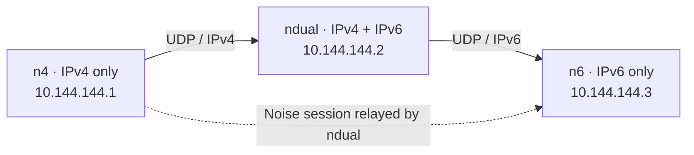

# Skein

[](https://github.com/Utsav-X-bit/Skein/actions/workflows/ci.yml)

Skein is a small, self-hosted mesh VPN for **2–5 of your own machines** on
Linux and Windows. It builds a private overlay network with no account, no
coordination server, and no vendor relay: peers find each other, route
through each other, and encrypt end to end.



`ndual` forwards opaque ciphertext; it never holds the `n4 ↔ n6` keys.

**Status:** `0.1.0-dev`. The mesh, desktop, CLI and installers are
implemented and exercised on real Linux and Windows 10 machines. Current
acceptance evidence and known limits are in
[`docs/engineering/PHASE4-ACCEPTANCE.md`](docs/engineering/PHASE4-ACCEPTANCE.md).

## What it gives you

- A TUN interface (`skein0` on Linux, `Skein` on Windows) with stable overlay
  addresses, so peers talk by IP like they share a LAN: `ssh user@10.144.144.2`.
- A per-pair **Noise IKpsk2** session. Traffic is encrypted for the two
  endpoints even when a third peer relays it.
- Peer discovery, distance-vector routing, NAT traversal, TCP fallback and
  failure recovery without a central service.
- A desktop control surface, a TUI dashboard, a CLI, and automatic firewall
  rules.

Default overlay: IPv4 `10.144.144.0/24` and IPv6 ULA `fd00:6d65:7368::/64`.
Default underlay port: `11010/udp` (TCP fallback on the same port).

## Install

### Linux — one command

From a checkout, as your normal desktop user:

```bash
bash scripts/install-linux.sh
```

The script detects Arch-family, Debian 13+/Ubuntu 24.04+ and Fedora 40+/RHEL
10+ systems, installs the required GTK4/WebKitGTK 6.0 and system packages,
builds all four binaries as your normal user with pinned Wails v3.1.0, and
uses `sudo` only for root-owned files, the helper, polkit policy and the
`skein` group. Older distro Node versions use a private, SHA-256-checked
Node 22 download.

```bash
bash scripts/install-linux.sh --dry-run
bash scripts/install-linux.sh --binary-dir gui/bin   # compatible prebuilt binaries
```

The script also works when copied out of the repository: it clones the
official `main` branch into a private temporary directory, or a branch/tag/
commit selected with `--source-ref`. Unpushed changes require
`--source-dir /path/to/Skein`. When run as root without `sudo`, pass
`--build-user USER`.

The installer does **not** create a network. Launch `skein-desktop` as your
normal user and choose **Create a network** or **Join a network**; that
bootstrap step registers and starts the service. On an upgrade it stops the
service, replaces the binaries, re-registers it and verifies running+enabled;
`/etc/skein` is kept. Quit the desktop from its tray menu before upgrading.

Supported: systemd distributions with GTK4 and WebKitGTK 6.0. Ubuntu 24.04
restricts unprivileged user namespaces; the installer adds a narrow AppArmor
profile for the desktop instead of weakening the global restriction.

### Windows 10/11 — setup executable

The x64 setup artifact is machine-wide (Administrator approval required). It
installs the desktop, `skeind.exe`, `skein-helper.exe`, `skein.exe`,
`wintun.dll` and its licence into `C:\Program Files\Skein`, with Start Menu
and desktop shortcuts. It verifies WebView2, refuses to run while the desktop
is open, stops a running service before an upgrade, and never deletes
`%ProgramData%\Skein` on uninstall.

A first install deliberately skips service registration: open the desktop
and create or join a network, which registers the service.

**1. Install the build prerequisites** (PowerShell):

```powershell
winget install GoLang.Go
winget install OpenJS.NodeJS.LTS
winget install NSIS.NSIS
go install github.com/wailsapp/wails/v3/cmd/wails3@v3.1.0
$env:PATH = "$env:USERPROFILE\go\bin;$env:PATH"
wails3 doctor
```

`wails3 doctor` must report no issues. NSIS must provide `makensis` on
`PATH`; for a portable/extracted NSIS tree, set `$env:NSISDIR` and pass
`MAKENSIS=<path>` to the build task.

**2. Build the complete setup**:

```powershell
cd $env:USERPROFILE\Downloads\Skein-test\gui
wails3 task windows:create:nsis:installer ARCH=amd64
# -> bin\skein-desktop-amd64-installer.exe
```

The task builds the system binaries and desktop, fetches the SHA-256-pinned
Wintun DLL, generates the WebView2 bootstrapper, and compiles NSIS. A missing
payload fails the build.

**3. Run the installer**:

```powershell
Start-Process .\bin\skein-desktop-amd64-installer.exe
```

Approve the UAC prompt (silent: add `/S`). It installs into
`C:\Program Files\Skein`. Then launch the desktop as your normal user and
create or join a network as described below.

## Use

### Desktop

1. Launch `skein-desktop` (Linux) or
   `C:\Program Files\Skein\skein-desktop.exe` (Windows).
2. First node: **Create a network**. Approve the UAC/pkexec prompt. The
   helper mints a single-use bootstrap token, the daemon writes config and
   identity, then runs normally. Copy the join string.
3. Other nodes: **Join a network**, paste the join string, approve elevation.

If a config already exists but the service is stopped, choose **Use an
existing installation**. Overview shows peers and routes; Security shows the
firewall manager, ownership, grants and a **Repair rules** action.

### Terminal

With the service installed, mesh commands use the local control
socket/pipe; no `sudo` is needed. Service lifecycle goes through the helper.

```bash
sudo skein system init [--name NAME] [--port PORT] [--mtu MTU]
sudo skein system join "skein:2:…"
sudo skein system start|stop|restart
skein system leave
skein system rotate
```

Windows, elevated for `system` commands:

```powershell
& "C:\Program Files\Skein\skein.exe" system init
& "C:\Program Files\Skein\skein.exe" system join "skein:2:…"
```

Everyday commands:

| Command | Purpose |
|---|---|
| `skein status [--json]` | Overlay addresses, peers, uptime, counters |
| `skein peers [list\|add]` | List peers or add a peer invite |
| `skein routes [--json]` | Reachability table |
| `skein probe <peer-id>` | Re-probe candidate endpoints |
| `skein ping <overlay-ip>` | Ping through the overlay |
| `skein invite` | Peer invite (`skein:1:…`, no secret) |
| `skein invite --network` | Network join string (`skein:2:…`, contains the secret) |
| `skein name [value]` | Show or set this node's name |
| `skein dashboard` | Live TUI (attaches to the running service) |
| `skein genkey` | Public key and node ID |
| `skein version` | Version and build commit |

Dashboard keys: `Tab`/`h`/`l` panels, `j`/`k` or arrows select, `Enter`
inspector, `Space` pause motion, `?` help, `q` quit. `--no-motion` renders a
static snapshot. The dashboard never starts a daemon.

Dev-only path, with no system service:

```bash
skein init
sudo skein run -c ~/.config/skein/skein.toml
skein dashboard
```

## How it works

### Privilege split

- **`skeind`** — the only privileged actor. Owns the TUN device, underlay
  sockets, firewall, config and identity.
- **`skein-helper`** — a fixed-verb elevated helper (bootstrap, install,
  uninstall, start/stop/restart/status, grant/revoke, set-owner). It is at
  `/usr/libexec/skein-helper` (Linux) and
  `C:\Program Files\Skein\skein-helper.exe` (Windows), and is deliberately
  not on `PATH`.
- **`skein-desktop` / `skein`** — unprivileged clients of the daemon's local
  control socket/pipe. Elevation goes through one helper call (pkexec/UAC).

The daemon authenticates the caller by kernel peer credentials and authorises
per local uid/SID role: `read`, `mutate` or `secret`. A one-time bootstrap
token admits the first caller; network-invite generation requires the
`secret` role and kernel transport.

### Overlay and sessions

Each node has a TUN interface and one IPv4 and optional IPv6 overlay address.
Every pair runs `Noise_IKpsk2_25519_ChaChaPoly_BLAKE2s` with explicit nonces,
a 64-packet replay window, and hourly / 2³²-packet rekeying. A frame carries
a small authenticated header; a relay may rewrite only the next-hop and TTL
fields, so it cannot read or alter payloads.

### Discovery and routing

- Static peers and peer/network invites.
- mDNS on the local link.
- Authenticated STATE gossip carrying names, candidates and reachability.
- STUN to learn the public address; local candidates include every interface
  address.
- Distance-vector routes with full paths, split horizon, at most four links.
  The lower peer ID dials by default; the other side can fall back after a
  silence timeout.
- TCP fallback when UDP is blocked; relay introductions (hole punching) when
  a direct path fails.

### Firewall

The daemon applies and repairs rules idempotently:

- **Linux:** ufw, firewalld, or raw iptables. Allows the underlay UDP port
  and trusts the overlay interface, so every protocol works without
  per-service rules.
- **Windows:** `Skein underlay` (inbound UDP), `Skein overlay` /
  `Skein overlay out` for the IPv4 prefix, and the IPv6 pair.

```bash
sudo ./scripts/firewall-linux.sh --port 11010 --interface skein0
```

The Security page shows the detected manager, owned rules, and a repair
action. The only underlay requirement is that one side of each pair is
reachable on the UDP port: a public address with a forward, public IPv6, or
the same LAN.

## Configuration

The daemon config is `/etc/skein/skein.toml` (Linux) or
`C:\ProgramData\Skein\skein.toml` (Windows), root/Administrator-owned. The
identity key lives beside it as `identity.key`.

```toml
[node]
overlay_ipv4_prefix = "10.144.144.0/24"
overlay_ipv6_prefix = "fd00:6d65:7368::/64"
overlay_ipv4        = "10.144.144.2"
overlay_ipv6        = "fd00:6d65:7368::2"   # optional; requires mtu >= 1280
listen_port         = 11010
network_secret      = "<32 random bytes, base64url>"
mtu                 = 1280
interface           = "skein0"              # Windows default: Skein
name                = "laptop"              # optional; shown to peers
public_addr         = "203.0.113.7:11010"   # only when the external port differs

[api]
socket = "/run/skein/control.sock"          # Linux service; helper-managed
# pipe = "skein-control"                    # Windows service
# listen = "127.0.0.1:11011"                # dev-only loopback listener
# token  = "<32 random bytes, base64url>"   # dev-only bearer token

[discovery]
mdns        = true
stun        = true
stun_server = "stun.l.google.com:19302"      # optional override
```

Unknown keys are rejected. The daemon refuses a config readable by group or
others. `api.listen` + `api.token` are for a user-run development daemon only;
the helper writes `api.socket`/`api.pipe` and disables the dev listener.

Full key reference: [`docs/protocol.md`](docs/protocol.md#configuration).

## Build from source

Requirements: Go 1.26.10+, Node.js 22, Wails v3.1.0, and the platform toolkit.

```bash
go install github.com/wailsapp/wails/v3/cmd/wails3@v3.1.0
export PATH="$PATH:$(go env GOPATH)/bin"
```

Linux packages (Arch / Debian / Fedora):

```bash
sudo pacman -S --needed git go nodejs npm gcc pkgconf gtk4 webkitgtk-6.0 acl polkit
sudo apt install git build-essential pkg-config libgtk-4-dev libwebkitgtk-6.0-dev acl policykit-1 nodejs npm
sudo dnf install git gcc pkgconf-pkg-config gtk4-devel webkitgtk6.0-devel acl polkit nodejs npm
```

```bash
mkdir -p gui/bin
(cd gui && wails3 task linux:build:system-binaries)   # skeind, skein-helper, skein
(cd gui && wails3 build)                              # skein-desktop
```

Windows package:

```powershell
cd gui
wails3 task windows:create:nsis:installer ARCH=amd64
```

Build artifacts land in `gui/bin/`. Wintun 0.14.1 is fetched and
SHA-256-verified by the packaging task.

## Testing

```bash
go test ./...
go test -race ./internal/session ./internal/dataplane ./internal/integration
(cd gui/frontend && npm test && npx tsc --noEmit)
bash scripts/install-linux-test.sh
bash scripts/packaging-assert.sh
bash scripts/collapse-gates.sh
```

Root-dependent daemon tests are run in disposable namespaces with
`-tags skeindev`. Native GUI smoke tests run the built desktop against a real
daemon; the installer test uses a disposable VM or container. See
[`docs/engineering/PHASE4-ACCEPTANCE.md`](docs/engineering/PHASE4-ACCEPTANCE.md)
for the exercised acceptance matrix.

## Limitations

- 2–5 nodes and routes of at most four links.
- Two symmetric-NAT peers need at least one reachable relay peer; there is
  no global relay network.
- The TCP fallback is plain TCP, not TLS.
- One shared network secret: anyone with the join string can join. Per-peer
  revocation is not implemented; eviction means rotating the secret and
  rejoining every node. Invitation expiry/inventory/attribution is deferred.
- No DNS, exit nodes, subnet routing, or mobile clients.
- No PMTUD or fragmentation; a dual-stack path below 1382 bytes PMTU is
  unsupported.
- Relays can observe peer IDs, sizes and timing, but not payloads.

## Repository layout

| Path | Contents |
|---|---|
| `cmd/` | `skeind`, `skein`, `skein-helper` entrypoints |
| `internal/` | protocol, session, routing, discovery, daemon, API, CLI |
| `gui/` | Wails desktop app, frontend, packaging |
| `scripts/` | installers, firewall helper, packaging gates |
| `docs/protocol.md` | wire format, config reference, protocol details |
| `docs/engineering/` | ADRs and acceptance reports |
| `test/` | namespace and Windows test harnesses |

No coordination service, account, or telemetry is involved. Nothing about a
mesh is reported to anyone; peers learn about each other directly.
