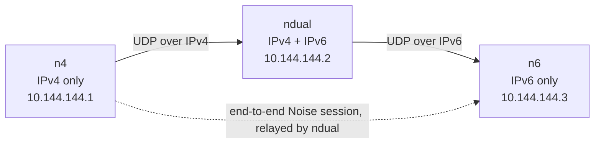

# Skein

[](https://github.com/Utsav-X-bit/Skein/actions/workflows/ci.yml)

Skein is a small, self-hosted mesh VPN for 2–5 of your own machines on
Linux and Windows — a Computer Networks project built to answer one
question end to end: **what does it actually take to get encrypted,
authenticated packets from one of my machines to another, across NATs,
across address families, with no server in the middle?**

The name is the design: a *skein* is a small coil of thread, and here
every peer is a thread woven into the same mesh. There is no hub, no
coordinator, and no account. Every peer is equal, every peer can relay
for others, and the mesh forms from the peers themselves.



`ndual` forwards opaque ciphertext: it never holds the `n4 ↔ n6` session keys.

> Status: `0.1.0-dev`. The architecture below is implemented; the
> final release verdict is still open (see
> `docs/engineering/M9-ACCEPTANCE.md`).

## Contents

- [What it is](#what-it-is)
- [How it works, fundamentally](#how-it-works-fundamentally)
- [Features](#features)
- [Skein vs Tailscale and other mesh VPNs](#skein-vs-tailscale-and-other-mesh-vpns)
- [Installation](#installation)
- [Usage](#usage)
- [Configuration](#configuration)
- [Firewall](#firewall)
- [Limitations](#limitations)
- [Future scope](#future-scope)
- [Testing](#testing)
- [Docs and layout](#docs-and-layout)

## What it is

Skein creates a private overlay network on top of the ordinary internet:

- Each machine gets a **TUN interface** (`skein0` on Linux, `Skein` on
  Windows) with a stable overlay address — IPv4 `10.144.144.0/24` and
  IPv6 ULA `fd00:6d65:7368::/64` by default — so machines talk to each
  other by overlay IP exactly as if they were on one LAN: `ssh
  user@10.144.144.2` just works, with no per-service port forwards.
- Every pair of machines negotiates its own **end-to-end encrypted
  session**. Traffic between two peers is encrypted for those two peers
  only, even when it crosses a third peer acting as a relay.
- Peers **discover and route to each other themselves** — no central
  server tells them where anyone is. Discovery, routing, NAT traversal,
  and failure recovery are all part of the protocol, not an external
  service.

It is deliberately small: 2–5 nodes, routes of at most 4 links, one
underlay port (default `11010`). That scope is what makes it feasible
to implement, audit, and explain completely — which is the point of a
networks project.

## How it works, fundamentally

The stack has four layers. Each one is a standard networking idea;
Skein is the composition of them.

### 1. The overlay: a TUN interface and two prefixes

The daemon creates a TUN device and assigns it an address from each
overlay prefix. The kernel routes overlay destinations into the TUN
device; the daemon reads those packets, encrypts them, and sends them
over the underlay (UDP, or TCP as a fallback). Incoming packets are
decrypted and written back into TUN, and the kernel delivers them to
local sockets. Applications never know the tunnel exists — they just
use overlay IPs.

MTU is 1280 by default. A 1280-byte inner packet becomes **1382 bytes
over IPv6** or **1362 bytes over IPv4** on the wire (see the frame
format below), so an underlay path with a smaller PMTU is unsupported:
there is no PMTUD or fragmentation yet.

### 2. The session: Noise IKpsk2 between every pair

Each node has an X25519 identity key; the peer ID is derived from its
public key, so a public key is self-certifying — if you know a peer's
ID, you can verify you are talking to that peer and no one else.

Pairs handshake with **`Noise_IKpsk2_25519_ChaChaPoly_BLAKE2s`**:

- **IK**: the initiator already knows the responder's static public
  key (from an invite or gossip), so the handshake authenticates both
  sides immediately — no unauthenticated first flight.
- **psk2**: a pre-shared key — the network secret from the join string
  — is mixed into the handshake, so only members of the same network
  can complete a handshake at all. Possession of the network secret is
  membership.
- The **epoch is bound into the prologue**, sessions install only after
  an encrypted confirmation, and at one epoch the smaller attempt ID
  (a 128-bit handshake identifier) wins, so simultaneous handshakes
  converge instead of duplicating sessions.
- Sessions **rekey every hour or 2³² packets**, with 64-packet replay
  windows per key epoch. A session that goes silent is dropped, never
  encrypted into.

### 3. The frame: a 26-byte header, relay-mutable in exactly two fields

```
[type:1][to_next:8][to_final:8][from:8][ttl:1] payload
```

The header is authenticated as AEAD associated data **except**
`to_next` and `ttl` — the only two fields a relay is allowed to
change. Encrypted frames add `[epoch:4][counter:8]` and a 16-byte
authentication tag. That is the whole relay contract in one sentence: a
relay rewrites `to_next` (who to hand the frame to next) and decrements
`ttl`, and cannot read, modify, or forge anything else. A relay sees
peer IDs, frame sizes, and timing — that metadata leakage is inherent
to relaying and is listed under [Limitations](#limitations).

### 4. Discovery, routing, and NAT traversal — the mesh itself

**Discovery.** A mesh forms without every pair exchanging invites.
Peers learn each other from static config, `skein:1:` peer invites
(identity + addresses, no secret), `skein:2:` network invites (which
carry the secret), mDNS on the local link, and **authenticated STATE
gossip**: every 5 seconds peers exchange signed state carrying overlay
addresses, names, and public keys. A STUN probe (default
`stun.l.google.com:19302`, optional) learns each node's public IPv4/IPv6
so joiners dial the right place without editing configs.

**Routing.** A bounded **distance-vector protocol with full paths and
split horizon**: advertisements carry the whole path, routes longer
than 4 links are rejected, and a peer never advertises a route back to
the peer it learned it from. The route table keeps the cheapest
validated path, and tries IPv6 first when it works. When a path dies,
the session is dropped and the dialer retries UDP, then TCP on the same
port, then the relayed route.

**NAT traversal.** One side of every pair must be reachable — a public
IPv4 with a forward, a public IPv6, or the same LAN — or the pair must
be introduced by a relay:

- **Direct** — dial the peer's advertised endpoint.
- **Relayed** — both sides connect to any reachable peer (a cheap VPS
  is enough); it forwards opaque ciphertext, as in the diagram above.
- **Introductions (hole punching)** — a peer reachable only through a
  relay asks the relay, which reports both observed endpoints; both
  sides dial each other at once. This works for endpoint-independent
  NAT; symmetric NAT keeps the relayed path.
- **TCP fallback** — after two silent UDP attempts the dialer opens
  TCP to the same port (set `listen_port = 443` to run both transports
  on 443). TCP frames are written in one syscall with Nagle disabled
  so the fallback does not collapse under delayed ACKs, and a datagram
  from the peer clears the TCP preference again, so a working UDP path
  always wins.

**Liveness.** Keepalive every 15 s keeps NAT mappings open. 45 s
without authenticated traffic marks a peer down, clears its cached
endpoint, drops the session, and withdraws its routes; a configured
dialer re-handshakes immediately instead of encrypting for a dead
address. Handshake retries back off 1 s → 30 s and reset as soon as a
route appears. A changed endpoint is only adopted after a
challenge/response over the existing session, so an attacker cannot
hijack a peer by announcing a new address.

**Leaving.** There is no "remove this other peer": every peer is
equal, anyone can invite, and a peer leaves itself (`skein system
leave`) and gossips a **tombstone** so all other peers withdraw its
routes. Leaving is graceful departure, not a ban — the leaver keeps
its credential until a network-wide secret rotation, and rejoining
needs a fresh invite. Rotation evicts only after the service restarts
and every legitimate node rejoins with the new secret.

### The control plane: one privileged daemon, one minimal helper

A VPN cannot run as a normal app: creating the TUN device, assigning
overlay addresses, installing routes, and opening firewall rules need
root on Linux or Administrator/SYSTEM on Windows. Skein therefore
splits privilege exactly once (ADR-001,
[`docs/engineering/ADR-001.md`](docs/engineering/ADR-001.md)):

- **`skeind` — the daemon/service — is the only privileged actor.** It
  owns the TUN device, routes, firewall, sessions, peers, and config
  (single writer, cross-process lock), and serves the control API:
  init/join/import, rotate, reset, leave, and self-update.
- **`skein-helper` — a fixed-verb elevated helper** — keeps only
  `bootstrap`, `install`, `uninstall`, `start`, `stop`, `restart`,
  `status`, `grant-user`, `set-owner` (Windows), and `revoke-user`.
  Every verb validates its inputs and returns one JSON object; secrets
  travel on stdin or a GUI-created pipe, never argv.
- **`skein` (CLI/TUI) and the desktop GUI are always unprivileged.**
  They talk to the daemon over a root-owned Unix socket
  (`/run/skein/control.sock`, 0660, `root:skein`) or a Windows named
  pipe (`\\.\pipe\skein-control`, DACL SYSTEM/Administrators/granted
  user), never through a shell. The daemon authenticates every caller
  by kernel transport (Unix `SO_PEERCRED` uid, Windows pipe SID) and
  authorises by role from the access file: `read` (status, peers,
  routes, diagnostics), `mutate` (config patches, probes, invites,
  firewall repair, leave), `secret` (network invites, rotate, reset,
  update, grants). A bind failure is fatal — the daemon never runs
  headless with a dead control plane.
- **Bootstrap** is the one place no config, identity, or grant exists
  yet, so it cannot go through the normal role-gated API. The helper
  (elevated via pkexec/UAC/polkit) checks that no system config
  exists, generates 256 bits with `crypto/rand`, and stores only the
  SHA-256 hash — root-owned 0600, with the invoking uid/SID, a
  10-minute expiry, and the verb it was minted for. The daemon starts
  in bootstrap mode (control plane only — no TUN, no UDP port, no
  mDNS, no firewall, not a mesh member) and accepts exactly one
  `POST /api/v1/bootstrap/init|join|import` with the token in the JSON
  body; verification order is transport → uid match → constant-time
  hash → expiry → unused, and five failed attempts burn the token. On
  success the token is marked used atomically before any config work,
  the bootstrap caller is granted the `secret` role, the state file is
  deleted, and the daemon switches in-process to normal mode.

## Features

- **End-to-end `Noise_IKpsk2_25519_ChaChaPoly_BLAKE2s`** between every
  pair, with explicit nonces, 64-packet replay windows, and hourly /
  2³²-packet rekeying.
- **Dual overlay**: IPv4 `10.144.144.0/24` and IPv6 ULA
  `fd00:6d65:7368::/64`, both configurable per node.
- **One underlay port** (default `11010`), dual-stack socket with a
  paired-socket fallback, plus TCP on the same port.
- **Discovery without a server**: static peers, peer/network invites,
  mDNS, authenticated STATE gossip, STUN.
- **Bounded routing**: distance vector with full paths, split horizon,
  at most four links; relays rewrite only `to_next` and `ttl`.
- **Relay introductions** (hole punching) with relayed-path fallback.
- **One privileged daemon, one minimal helper** (ADR-001); GUI and CLI
  unprivileged; role-gated control API; single-use bootstrap tokens.
- **Automatic firewall**: the daemon opens the underlay port and
  trusts the overlay interface (ufw, firewalld, raw iptables fallback,
  or Windows Firewall), so any protocol works without extra rules.
  The desktop Security page shows the manager, owned rules, and a
  repair action.
- **Self-maintaining config**: learned peers are written back to the
  TOML atomically, so a restart keeps the mesh.
- **Named nodes**: `node.name` travels in STATE gossip and appears in
  the dashboard, `skein peers`, and the API.
- **Signed, operator-driven self-update**: staged ed25519 + SHA-256
  manifest with `key_id` and signed `valid_until`; downgrades refused;
  verified rollback restores the previous binary and config. No
  automatic checks, no version feed.
- **Mission-control dashboard**: `skein dashboard` adapts from compact
  to wide terminals, renders only known route paths, and shows
  per-link throughput, transport, RTT, jitter, and authenticated
  aggregate mesh activity (byte deltas and link performance only —
  never packet contents, overlay addresses, ports, or flow IDs).

## Skein vs Tailscale and other mesh VPNs

Tailscale is the reference point most people know: WireGuard-based,
with a **coordination server** that authenticates users (usually via
SSO), distributes keys and routes, and runs a global **DERP relay
network**, plus MagicDNS, ACLs, exit nodes, and subnet routers. It is
excellent, mature, and operated by a company. Skein makes the opposite
trade on purpose.

| | Skein | Tailscale (typical) |
|---|---|---|
| Control plane | None — peers gossip state to each other | Coordination server + account/SSO |
| Relay network | Any reachable peer of yours (e.g. a cheap VPS) | Global DERP network run by the vendor |
| Cryptography | Noise IKpsk2, custom wire format | WireGuard protocol |
| Discovery | mDNS, gossip, STUN, invites | Coordination server |
| DNS | None (use overlay IPs or your own DNS) | MagicDNS |
| Access control | Control-plane roles per local uid/SID; one shared network secret | ACLs, SSO, device approval |
| Exit nodes / subnet routes | No | Yes |
| Platforms | Linux, Windows (desktop + CLI) | Linux, Windows, macOS, iOS, Android |
| Scale | 2–5 nodes, routes ≤ 4 links | Thousands of nodes |
| Trust | Nobody but your peers; no vendor sees metadata | Vendor operates coordination + DERP |

**Where Skein wins:**

- **No account, no server, no vendor.** Nothing about your mesh —
  membership, routes, activity — is reported to anyone. A mesh works
  entirely on a LAN with no internet at all (mDNS + gossip; STUN is
  optional).
- **Relay without a third party.** Any peer you already trust can be
  the relay, and relaying is opaque by construction (two mutable
  header fields, everything else AEAD-authenticated).
- **Small and auditable.** The whole design — handshake, frame,
  routing, discovery, privilege split — fits in one README and two
  ADRs. There is no coordination protocol to trust blindly.
- **Dual-stack bridging for free.** An IPv4-only host and an
  IPv6-only host communicate through a dual-stack peer, end to end
  encrypted, with no special configuration.

**Where Skein lacks (honestly):**

- **No global relay network.** If no peer of yours is reachable from
  the internet, two symmetric-NAT peers cannot connect. Tailscale's
  DERP network solves this by existing everywhere; Skein asks you to
  provide one reachable peer.
- **No DNS, exit nodes, or subnet routing.** You address peers by
  overlay IP, and only overlay IPs are routed.
- **No per-peer revocation.** One shared secret is membership; evicting
  a peer means rotating the secret and rejoining every legitimate node.
  Per-peer invites are future work, not a feature.
- **No mobile clients, no SSO, no ACLs** beyond local control-plane
  roles.
- **Smaller scale and younger code.** Five nodes and four-link routes
  are hard limits, and the implementation has not had Tailscale's
  years of adversarial production use.

## Installation

Skein ships as five pieces:

| File | Purpose |
|---|---|
| `skeind` | Privileged daemon / system service (the only privileged actor) |
| `skein` | Unprivileged CLI, TUI dashboard, and control-API client |
| `skein-helper` | Elevated minimal helper (retained verbs only) |
| `skein-desktop` | Wails desktop control surface (unprivileged) |
| `wintun.dll` | Windows tunnel driver (Windows only) |

There are exactly two ways to install Skein. **Method 1** is the
universal, complete Windows setup executable: one artifact that
installs all five pieces. **Method 2** builds from source, with a
Linux path and a Windows path. Both end at the same place: create or
join a network (see [Usage](#usage)).

Three facts apply to every install:

- **The service is registered by bootstrap, not by install.** The
  helper's `install` verb needs an existing system config
  (`/etc/skein/skein.toml` on Linux, `%ProgramData%\Skein\skein.toml`
  on Windows) and is for upgrades and reinstalls. A first install only
  puts the files in place. The first `init`, `join`, or `import` —
  from the desktop or `skein system init|join|import` — mints a
  one-time bootstrap token through the helper, registers the service,
  and starts the daemon. Running `skein-helper install` on a fresh
  machine fails by design.
- **The desktop is never run as root or Administrator.** It is
  unprivileged: it talks to the daemon over the root-owned
  `/run/skein/control.sock` (Linux) or the named pipe
  `\\.\pipe\skein-control` (Windows), and every privileged action goes
  through one fixed-verb helper call, elevated by pkexec (Linux) or
  UAC (Windows). Run the desktop as your normal user.
- **The helper is not on `PATH`.** Call it by its full path:
  `/usr/libexec/skein-helper` on Linux (it is also absent from sudo's
  `secure_path`) and `C:\Program Files\Skein\skein-helper.exe` on
  Windows.

### Method 1 — Windows setup executable (recommended)

The setup executable is the universal, complete install: one artifact
ships the desktop, `skeind.exe`, `skein-helper.exe`, `skein.exe`, and
the Wintun DLL and licence, and installs them into
`C:\Program Files\Skein` with Start Menu and desktop shortcuts.

It is a build artifact, not a file in this repository, and this
repository hosts no prebuilt installer. Use the copy you were
given, or produce it once from a checkout on Windows. Producing it
needs the Windows prerequisites from
[Method 2](#method-2--build-from-source) (Go, Node.js + npm, Wails 3
v3.1.0) plus NSIS 3.x with `makensis` on `PATH`; the packaging task
builds the system binaries, fetches the pinned, SHA-256-verified Wintun
DLL, and generates the WebView2 bootstrapper. Run the build from the
repository root in a PowerShell session where `wails3` and `makensis`
are on `PATH` (the first line adds the usual Go and NSIS locations for
this session):

```powershell
$env:PATH = "$env:USERPROFILE\go\bin;C:\Program Files (x86)\NSIS;$env:PATH"
cd gui
wails3 build      # desktop -> gui\bin\skein-desktop.exe
wails3 package    # -> gui\bin\skein-desktop-amd64-installer.exe
cd ..
```

Run the installer from the repository root (it requests Administrator
itself; `/S` installs silently):

```powershell
.\gui\bin\skein-desktop-amd64-installer.exe
```

On an arm64 host the artifact is
`skein-desktop-arm64-installer.exe`.

What it does:

- Copies all five pieces (plus the Wintun licence) into
  `C:\Program Files\Skein` and creates shortcuts. It does not delete
  your config, identity, or access files: on upgrade the helper may
  rewrite the config only to migrate the control transport, and keeps
  a timestamped backup beside it. Uninstall without purge keeps your
  config, identity, and access files.
- On an upgrade it stops the running `skein` service first, then —
  only when `%ProgramData%\Skein\skein.toml` already exists — runs
  `skein-helper.exe install` to re-register and start it. A silent
  install aborts if that fails; the interactive installer shows the
  full path and command to finish by hand.
- On a first install there is no config, so it deliberately skips
  service registration and says so. Open the app and create or join a
  network; that bootstrap step registers the service.
- Firewall rules are created by the daemon when it starts; the
  installer itself adds none. Uninstall with
  `C:\Program Files\Skein\uninstall.exe` (or Settings → Apps): it runs
  the helper's `uninstall` verb first, so no orphaned service is left
  behind; without purge, config, identity, and access files are kept.
  `/S` is silent and never purges.

Launch `C:\Program Files\Skein\skein-desktop.exe` as your normal user
and choose **Create a network** or **Join a network** (see
[Usage](#usage)).

### Method 2 — Build from source

**Prerequisites — install these first.**

| | Linux | Windows |
|---|---|---|
| Go | 1.26.10+ (`go.mod`) | 1.26.10+ |
| Git | any (the steps clone the source) | Git for Windows |
| Node.js + npm | 22 LTS (CI uses 22; the frontend builds with Vite 8) | 22 LTS (same) |
| Wails 3 CLI | v3.1.0 | v3.1.0 |
| Desktop toolkit | GTK4 + WebKitGTK 6.0 development packages, gcc, pkg-config | WebView2 runtime (current Windows 10/11) |
| System runtime | systemd, polkit (`pkexec`), `acl` (`setfacl`), `iproute2` | — |
| Privilege | `sudo` to install files; pkexec for service verbs | elevated PowerShell (Administrator) |
| Setup exe only (Method 1) | — | NSIS 3.x with `makensis` on `PATH` |

Install the Wails CLI once (it is a Go install), then add Go's bin
directory to `PATH` for this shell:

```bash
go install github.com/wailsapp/wails/v3/cmd/wails3@v3.1.0
export PATH="$PATH:$(go env GOPATH)/bin"
```

```powershell
go install github.com/wailsapp/wails/v3/cmd/wails3@v3.1.0
$env:PATH = "$env:USERPROFILE\go\bin;$env:PATH"
```

Linux toolkit packages (pick your distro):

```bash
# Arch
sudo pacman -S --needed git go nodejs npm gcc pkgconf gtk4 webkitgtk-6.0 acl polkit

# Debian / Ubuntu
sudo apt install git build-essential pkg-config libgtk-4-dev libwebkitgtk-6.0-dev acl policykit-1 nodejs npm

# Fedora
sudo dnf install git gcc pkgconf-pkg-config gtk4-devel webkitgtk6.0-devel acl polkit nodejs npm
```

If `node --version` reports older than 22, install Node 22 LTS from
nodejs.org before building. Then confirm the toolchain:

```bash
wails3 doctor
```

`wails3 doctor` reports anything the package names above missed.

**Ubuntu 24.04+ note.** The desktop is a WebKitGTK app. Ubuntu's
AppArmor policy restricts unprivileged user namespaces, which the
WebKit web process needs to sandbox itself: without them the app exits
at startup with `bwrap: setting up uid map: Permission denied` /
`Failed to fully launch dbus-proxy`. Allow them (this is the upstream
kernel default, not a Skein-specific privilege):

```bash
sudo sysctl -w kernel.apparmor_restrict_unprivileged_userns=0
echo 'kernel.apparmor_restrict_unprivileged_userns=0' | sudo tee /etc/sysctl.d/99-skein-userns.conf
```

**Linux — build and install by hand.** The commands clone the
repository and run from its root. Both the system binaries and the
desktop land in `gui/bin/` (the desktop is a Wails output, not a
repository-root file); the helper is installed to `/usr/libexec/`.

```bash
git clone https://github.com/Utsav-X-bit/Skein && cd Skein
mkdir -p gui/bin
(cd gui && wails3 task linux:build:system-binaries)   # -> gui/bin/{skeind,skein-helper,skein}
(cd gui && wails3 build)                              # -> gui/bin/skein-desktop

sudo install -m 0755 gui/bin/skeind /usr/local/bin/skeind
sudo install -m 0755 gui/bin/skein /usr/local/bin/skein
sudo install -m 0755 gui/bin/skein-desktop /usr/local/bin/skein-desktop
sudo install -m 0755 gui/bin/skein-helper /usr/libexec/skein-helper
sudo install -D -m 0644 gui/build/linux/nfpm/org.skein.helper.policy \
  /usr/share/polkit-1/actions/org.skein.helper.policy
getent group skein >/dev/null || sudo groupadd -r skein
```

The packaged polkit policy gives `pkexec /usr/libexec/skein-helper`
a Skein-specific administrator prompt. pkexec selects that policy by
the helper’s executable path; it does not accept an `--action` flag.
The `skein` group owns `/run/skein/control.sock` (`0660 root:skein`);
the helper grants the installing/granted uid a per-user socket ACL.
The helper writes the systemd unit itself when the service is
registered, so there is no unit file to copy here.

Only on an upgrade or reinstall over an existing network — never on a
first install — re-register and start the service:

```bash
sudo /usr/libexec/skein-helper install
sudo /usr/libexec/skein-helper status
```

The helper rewrites the config only to migrate the control transport
and keeps a timestamped backup beside it; identity and network
membership are unchanged.

Then create or join a network (see [Usage](#usage)). The daemon applies
its firewall rules at startup; to apply them early or repair them
without starting the daemon:

```bash
sudo ./scripts/firewall-linux.sh --port 11010 --interface skein0
sudo ./scripts/firewall-linux.sh --remove   # undo exactly those rules
```

The script detects ufw (active) → firewalld (running) → raw iptables
in that order, mirroring the daemon's own detection, and prints the
manager it used.

**Uninstall (source install).** Run the helper's uninstall verb before
removing the files it needs; it stops the service and removes the
firewall rules. The config and identity are kept.

```bash
sudo /usr/libexec/skein-helper uninstall &&
  sudo rm -f /usr/local/bin/skeind /usr/local/bin/skein \
    /usr/local/bin/skein-desktop /usr/libexec/skein-helper \
    /usr/share/polkit-1/actions/org.skein.helper.policy
```

`/etc/skein`, `/var/lib/skein/backups`, and the `skein` group are kept.
Purge is the daemon reset endpoint (before uninstall) or a manual
removal of `/etc/skein` and `/var/lib/skein/backups`; these commands
keep both.

To produce a distro package instead of installing by hand, run the
matching packaging task from `gui/`; it builds the desktop and the
system binaries into `gui/bin/`:

```bash
cd gui
wails3 task linux:create:deb    # or linux:create:rpm / linux:create:aur
cd ..
```

Install the resulting package from `gui/bin/` with your package
manager. A packaged install also ships the unit template, group,
tmpfiles entry, and polkit policy described in [Packaging](#packaging).

**Windows — build and install by hand.** Run the build in a normal
PowerShell window; the commands clone the repository and run from its
root. The Wails CLI lands in `%USERPROFILE%\go\bin`, which is not on
`PATH` by default; the first line adds it for this session. All four
binaries are built into `gui\bin\`, and the install script is pointed
there explicitly.

```powershell
$env:PATH = "$env:USERPROFILE\go\bin;$env:PATH"

git clone https://github.com/Utsav-X-bit/Skein
cd Skein
New-Item -ItemType Directory -Force gui\bin | Out-Null

cd gui
wails3 task windows:build:system-binaries   # -> gui\bin\{skeind,skein-helper,skein}.exe
wails3 build                                # -> gui\bin\skein-desktop.exe
cd ..

.\scripts\fetch-wintun.cmd -Dest gui\bin
# arm64 host: add -Arch arm64 to the fetch command
```

Then install from an elevated PowerShell in the same repository root:

```powershell
powershell -NoProfile -ExecutionPolicy Bypass -File .\scripts\install-windows.ps1 -SourceDir .\gui\bin
```

The script copies `skeind.exe`, `skein-helper.exe`, `skein.exe`,
`wintun.dll`, `wintun-LICENSE.txt`, and `skein-desktop.exe` into
`C:\Program Files\Skein`, creates the same firewall rules the daemon
manages, and — only when `%ProgramData%\Skein\skein.toml` already
exists — registers and starts the service through the helper. On a
first install it skips registration and prints the next steps. It does
not delete your config or identity; on upgrade the helper may rewrite
the config only to migrate the control transport and keeps a
timestamped backup beside it, so reinstalls keep your network
membership. Re-running it upgrades in place.

Then create or join a network (see [Usage](#usage)); Windows `system`
commands need an elevated PowerShell.

**Uninstall (source install).** Close Skein Desktop, then run the
helper's uninstall verb from an elevated PowerShell before deleting the
install directory; it stops the service and removes the firewall rules.
The config and identity in `%ProgramData%\Skein` are kept.

```powershell
& "C:\Program Files\Skein\skein-helper.exe" uninstall
if ($LASTEXITCODE -ne 0) { throw "skein-helper uninstall failed; nothing deleted" }
Remove-Item -Recurse -Force "C:\Program Files\Skein"
```

To purge, use the daemon reset endpoint before uninstalling, or move or
delete `%ProgramData%\Skein` by hand; this keeps it.

**Git Bash note:** do not paste the PowerShell commands into Git
Bash — backslashes escape the next character, so
`.\scripts\fetch-wintun.cmd` becomes `.scripts\fetch-wintun.cmd`.
Use forward slashes and install the Wails CLI into `$HOME/go/bin`. Use
Windows Terminal or `winpty` for the animated TUI; MinTTY gets the
static snapshot.

**Upgrading from a pre-dev install.** Config and identity are adopted
unchanged, but the old access file holds a bare uid (Linux) or SID
(Windows), which the dev code maps to the `read` role — the owner
cannot revoke, rotate, or use secret endpoints until promoted:

```bash
sudo /usr/libexec/skein-helper grant-user 1000 --role secret   # Linux
```

```powershell
& "C:\Program Files\Skein\skein-helper.exe" set-owner <your-username>   # Windows
```

The Windows form writes `<SID>:secret` and reports
`restart_required: true` — restart the service after it.

## Usage

### Desktop (GUI)

**First node**

1. Launch `skein-desktop` (Linux) or
   `C:\Program Files\Skein\skein-desktop.exe` (Windows).
2. Choose **Create a network**. The defaults are usually enough; set a
   name if you want peers to see it.
3. Approve the UAC/`pkexec` prompt. The helper mints a single-use
   bootstrap token and starts the daemon in bootstrap mode; the daemon
   writes the config and identity as the single writer and then runs
   normally.
4. Copy the join string shown by the app.

**Other nodes**

1. Launch the desktop and choose **Join a network**.
2. Paste the join string.
3. Approve the elevation prompt. The node bootstraps, joins, and starts
   automatically.

If `/etc/skein` (Linux) or `C:\ProgramData\Skein` (Windows) already
exists but the service is stopped, choose **Use an existing
installation** instead of creating a new network. The Overview page
shows peers and routes; Security shows the firewall manager and repair
action.

### Terminal

With the service installed, the CLI attaches over the control
socket/pipe; no `-c` or `sudo` is needed for mesh commands (service
lifecycle goes through the helper):

```bash
# First node: the helper mints a single-use bootstrap token and starts
# the daemon in bootstrap mode; the CLI posts it to the daemon bootstrap
# endpoint.
sudo skein system init [--name NAME] [--port PORT] [--mtu MTU]
# Joining node:
sudo skein system join "skein:2:…"
# Then: lifecycle via the helper, mesh operations via the daemon API:
sudo skein system start     # start the service
sudo skein system stop      # stop the service
sudo skein system restart   # restart the service
skein system leave        # leave this node's own network (see Limits)
skein system rotate       # rotate the network secret via the daemon, then helper restart
```

Windows (from `C:\Program Files\Skein`, elevated for `system` commands):

```powershell
.\skein.exe system init
.\skein.exe system join "skein:2:…"
.\skein.exe system start
```

### Everyday commands

| Command | Purpose |
|---|---|
| `skein status [--json]` | Overlay addresses, peers, uptime, counters |
| `skein peers [list\|add]` | Manage peers (no removal: a peer leaves itself) |
| `skein routes [--json]` | Reachability table |
| `skein probe <peer-id>` | Re-probe candidate endpoints |
| `skein ping <overlay-ip>` | Ping through the overlay |
| `skein invite` | Print `skein:1:<base64url>` (identity + addresses, no secret) |
| `skein invite --network` | Print the `skein:2:` join string (contains the secret) |
| `skein name [value]` | Show or set this node's name |
| `skein dashboard` | Live TUI; attaches to the service socket/pipe |
| `skein genkey` | Print the public key and node ID |
| `skein version`, `skein -v` | Version plus the commit the binary was built from |

Dashboard keys: `Tab`/`h`/`l` panels, `j`/`k` or arrows select,
`Enter` inspector, `Space` pause motion, `?` help, `q` quit.
`--no-motion` renders a static snapshot. If no daemon is answering,
the dashboard reports that and does not start one: it never spawns a
daemon. Under `sudo` the invoking user's config is used.

**Dev-only path** (no service; the system path above is the supported
one):

```bash
skein init                                  # prints a join string
sudo skein run -c ~/.config/skein/skein.toml
# in another terminal:
skein dashboard
```

Join another node with `skein join "skein:2:…"` before starting its
daemon. `skein run` is the dev path only; the service uses
`/etc/skein` (Linux) or `%ProgramData%\Skein` (Windows).

### Naming nodes

```bash
skein name "utsav-laptop"     # show or set this node's name
```

The name is advertised in STATE gossip, so every peer displays it
instead of a peer ID. A peer can also be given a local hint before
first contact:

```toml
[[peer]]
id     = "b3f64ecc491aba35"
name   = "yoga"
pubkey = "…"
```

The name a peer advertises about itself always wins over the local hint.

## Configuration

```toml
[node]
overlay_ipv4_prefix = "10.144.144.0/24"
overlay_ipv6_prefix = "fd00:6d65:7368::/64"
overlay_ipv4        = "10.144.144.2"
overlay_ipv6        = "fd00:6d65:7368::2"   # optional; requires mtu >= 1280
listen_port         = 11010
network_secret      = "<32 random bytes, base64url>"
mtu                 = 1280
interface           = "skein0"              # Windows default: Skein
name                = "utsav-laptop"        # optional, shown to peers (default: hostname)
public_addr         = "203.0.113.7:11010"   # optional: only when the external port differs

[api]
socket = "/run/skein/control.sock"          # Linux service; helper-managed
# pipe = "skein-control"                    # Windows service
listen = "127.0.0.1:11011"                  # dev-only loopback listener
token  = "<32 random bytes, base64url>"     # dev-only bearer token

[discovery]
mdns        = true
stun        = true                           # learn and advertise the public IPv4/IPv6
stun_server = "stun.l.google.com:19302"      # optional override
```

The desktop/service config is `/etc/skein/skein.toml` on Linux and
`C:\ProgramData\Skein\skein.toml` on Windows, root/Administrator-owned;
the helper writes `api.socket` or `api.pipe` and disables the dev TCP
listener. `api.listen` + `api.token` are for a user-run dev daemon
only. Unknown keys are rejected. The daemon refuses a config readable
by group or others, and the X25519 key lives in `<config
dir>/identity.key` with owner-only permissions.

Full key-by-key reference: [`docs/protocol.md`](docs/protocol.md#configuration).

## Firewall

`skein run` opens what it needs at startup, idempotently:

- **Linux** — with `ufw` active it allows `<port>/udp`, all traffic on
  the overlay interface, and the matching route rules; with `firewalld`
  it adds the port and puts the interface in the trusted zone;
  otherwise it appends `INPUT`/`OUTPUT`/`FORWARD` accepts for the
  interface and underlay port.
- **Windows** — it creates `Skein underlay` (inbound UDP on the port),
  `Skein overlay` (all inbound traffic from the overlay prefix),
  `Skein overlay out` (all outbound traffic to the overlay prefix),
  and the v6 pair — scoped by prefix, because `netsh` cannot scope a
  rule to a named interface.

The desktop Security page reports the detected manager, the owned rule
set, config/identity ownership and modes, socket ACL, update signature,
and a **Repair rules** action. A systemd sandbox must allow
`/run/ufw.lock` for `ufw status` to work; the shipped unit does.

Because the overlay interface is trusted, every protocol works without
per-service rules:

```bash
ssh user@10.144.144.2
python3 -m http.server 8000 --bind 10.144.144.1
```

The only underlay requirement is that **one side of each pair is
reachable** on the UDP port: a public IPv4 with a forward, a public
IPv6, or the same LAN. SSH and every other protocol travel inside the
tunnel and never need their own router forward.

**Manual firewall setup** (pre-seed a host, or repair after an external
firewall reset, without starting the daemon):

```bash
# Linux: detects ufw -> firewalld -> iptables, mirroring the daemon
sudo ./scripts/firewall-linux.sh --port 11010 --interface skein0

# Windows: no separate step — the daemon creates the rules at startup,
# and the source install script pre-creates the same set.
```

## Reaching peers behind NAT — examples

| A | B | C | Result |
|---|---|---|---|
| CGNAT v4 + public v6 | CGNAT v4 + public v6 | public v4 | A↔B **direct over IPv6**; A↔C and B↔C direct if C has IPv6, otherwise relayed through whichever node does |
| CGNAT v4 + public v6 | public v4 + public v6 | CGNAT v4 | A↔B direct over IPv6; C dials B over IPv4; A↔C relayed through B |
| CGNAT v4 + public v6 | public v4 + public v6 | CGNAT v4 + no v6 | same, with C dialing B and B forwarding |

Candidates include every interface address (v4 and v6), so the dialer
tries IPv6 first when it works; the route table then keeps the cheapest
validated path. IPv6 needs UDP `<port>` open on the listener's host
firewall, which the daemon configures automatically.

Not implemented: TLS camouflage and a global DERP-style relay network.
STUN is implemented (`discovery.stun`); the probes learn the public
IPv4/IPv6.

## Packaging

- **Linux (nfpm, `gui/build/linux/nfpm/nfpm.yaml`)**: ships
  `skein-desktop` (`/usr/local/bin/skein-desktop`), `skeind`
  (`/usr/local/bin/skeind`), `skein-helper`
  (`/usr/libexec/skein-helper`), `skein` (`/usr/local/bin/skein`),
  the systemd unit (`/usr/lib/systemd/system/skein.service`,
  `ExecStart=/usr/local/bin/skeind run -c /etc/skein/skein.toml`),
  the `skein` group (sysusers, `g skein -`), the runtime directory
  (tmpfiles, `/run/skein 0750 root skein`), and the polkit policy
  (`/usr/share/polkit-1/actions/org.skein.helper.policy`). The unit
  and the shipped template agree on `ExecStart`; upgrades adopt the
  new binary through `RegisterDaemon` without rewriting the unit, and
  `<binary>.old` plus a timestamped config backup are kept on every
  upgrade. Uninstall never purges config by default (Linux keeps
  `/etc/skein` and `/var/lib/skein/backups`); purge is the daemon
  reset endpoint, not the helper. Build it as in Installation,
  Method 2 (Linux) — the package build, install, and (on upgrade)
  service activation are there in order.
- **Windows (NSIS, `gui/build/windows/nsis/project.nsi`)**: ships the
  desktop, `skeind.exe`, `skein-helper.exe`, `skein.exe`, `wintun.dll`,
  and the Wintun licence into `C:\Program Files\Skein`. The build
  fails if any required binary is missing. Install stops a running
  service first (upgrade), then — when a network already exists —
  re-registers and starts the service through the helper; on a first
  install there is no config yet, so the service is registered by the
  bootstrap flow when the first network is created. Uninstall runs the
  helper's `uninstall` verb first (stop-then-delete) and aborts without
  deleting anything if the helper fails, so no orphaned service is left
  behind; purge moves `%ProgramData%\Skein` to `.bak` instead of
  deleting it.
- **Wintun**: version 0.14.1, SHA-256-pinned in
  `scripts/fetch-wintun.sh` (`.ps1`/`.cmd` wrappers for Windows). The
  packaged NSIS install places the DLL in the admin-only install
  directory; a portable/zip layout in a user-writable directory is not
  a blessed install.
- **Self-update**: operator-driven, never automatic. The operator
  stages a signed manifest (ed25519 + SHA-256, `key_id` + signed
  `valid_until`, basename-only binary under the staging directory);
  the daemon's `GET /api/v1/system/update/check` verifies it and
  refuses downgrades (the new version must be strictly greater — a
  genuine downgrade is a package reinstall, not an update), and `POST
  /api/v1/system/update/apply` launches a detached apply process with
  verified rollback: on failure the previous binary and config are
  restored and the `.old`/config backups are never deleted. The
  manifest may carry operator-facing `release_notes` (max 64 KiB)
  with a separate `notes_signature`: base64 ed25519 over
  `hex(sha256(release_notes))`, signed by the same `key_id` key.
  Notes are optional and never change the legacy signature payload
  (`version\nbinary\nsha256\nkey_id\nvalid_until`), so older
  manifests verify unchanged; when present, the check response
  returns only signature-verified notes and rejects missing,
  invalid, or oversized signatures. The GUI About/Updates screen
  drives check/apply; there is no version-feed endpoint and no
  automatic check.
- Content assertions: `scripts/packaging-assert.sh` parses both
  manifests and fails if a shipped file, the install directory, the
  uninstall order, or the purge behaviour drifts;
  `scripts/collapse-gates.sh` enforces the collapse invariants (single
  writer, no daemon spawn from GUI/CLI, no removed helper verb called
  from GUI/CLI, no removed endpoint, no secret logging). Both run in CI.

## Limitations

- Two symmetric-NAT peers still need a reachable relay peer; there is
  no global relay network.
- The TCP fallback is plain TCP, not TLS; it defeats UDP blocking but
  not deep-packet inspection.
- IPv4-only ↔ IPv6-only needs a dual-stack member; no common family,
  no path.
- More than five nodes or routes longer than four links are
  unsupported.
- No PMTUD or fragmentation; a dual-stack underlay path below 1382
  bytes of PMTU is unsupported.
- One shared secret, no per-peer revocation. The join string contains
  that secret, so anyone holding it can join the network. There is no
  "remove this other peer": every peer is equal, anyone can invite,
  and a peer leaves itself and gossips a tombstone (see [How it
  works](#how-it-works-fundamentally) and `docs/protocol.md`). Leaving
  is graceful departure, not a ban — the leaver keeps its credential
  until a network-wide secret rotation, and rejoining needs a fresh
  invite. Rotation evicts only after the service restarts and every
  legitimate node rejoins with the new secret.
- The control API authenticates the caller by kernel transport and
  authorises by role; a process running as a granted uid can use only
  its role's endpoints. Relays can observe peer IDs, sizes, and timing.
- No DNS, exit nodes, subnet routing, or mobile clients (see the
  comparison above).

## Future scope

Near term, in rough order of value:

- **Per-peer invites and revocation** (the deferred F-01): replace the
  single shared secret with per-peer credentials so one peer can be
  evicted without rejoining the whole network. Needs its own ADR and
  live-mesh verification.
- **Larger meshes**: link-state routing to replace distance vector,
  lifting the 5-node / 4-link caps without losing loop-freedom.
- **PMTUD and fragmentation**: probe the underlay path MTU and
  fragment inner packets, instead of requiring a 1382-byte PMTU.
- **Camouflaged fallback**: TLS or QUIC transport for the TCP fallback
  so it survives deep-packet inspection, not just UDP blocking.
- **Global relay option**: an opt-in, self-hostable DERP-style relay
  for peers with no reachable member — without making it mandatory.
- **DNS, exit nodes, subnet routes**: overlay DNS resolution, a
  designated egress peer, and advertising LAN prefixes behind a peer.
- **Mobile clients** (Android/iOS) and a headless-first onboarding
  flow for servers.
- **Measurement**: reproducible throughput/latency/convergence
  benchmarks against WireGuard and Tailscale on the same hardware
  (see `docs/measurements.md` for the current method).

## Testing

```bash
go test -race ./...
(cd gui && wails3 build)                            # desktop compile
sudo -E env "PATH=$PATH" ./test/netns/run.sh        # v4-only ↔ v6-only bridge
SKEIN_TUN_PROBE=1 sudo -E env "PATH=$PATH" \
  go test ./internal/tun -run TestTUNWriteRead -v    # TUN kernel round-trip
```

TUI smoke: `skein dashboard` with the service running should attach
over the socket/pipe and quit with `q`. Windows: build with
`test/windows/build.ps1`, then run `test/windows/run-all.ps1 -Bin
.\dist` from an elevated PowerShell (see
[`test/windows/README.md`](test/windows/README.md)).

## Docs and layout

- [`docs/protocol.md`](docs/protocol.md) — wire format, handshake,
  routing, discovery, configuration.
- [`docs/measurements.md`](docs/measurements.md) — what was measured
  and how to reproduce it.
- [`docs/gui-api.md`](docs/gui-api.md) — desktop/daemon API contract.
- [`docs/engineering/ADR-001.md`](docs/engineering/ADR-001.md) — the
  one-daemon/one-helper collapse.
- [`docs/engineering/M9-ACCEPTANCE.md`](docs/engineering/M9-ACCEPTANCE.md)
  — the machine-verification checklist.

```
cmd/skein                 CLI, TUI dashboard, and control-API client
cmd/skeind                thin daemon wrapper
cmd/skein-helper          fixed-verb elevated helper for the desktop
gui/                      Wails desktop app, services, frontend, packaging
internal/identity         X25519 keys, peer IDs, invites
internal/conf             TOML schema, defaults, validation
internal/wire             bounded frame codec
internal/session          Noise handshakes, epochs, replay windows
internal/link             UDP/TCP transport
internal/tun, internal/netcfg   TUN creation, addresses, routes, MTU
internal/peer, internal/path    peer table, candidate probing
internal/route            bounded distance-vector routing
internal/discovery        mDNS and authenticated state gossip
internal/dataplane        packet plane, forwarding, counters
internal/control          keepalive, state sync, rekey, probes
internal/api, internal/daemon   loopback API and composition
internal/app              daemon entry points shared by both binaries
internal/cli              CLI, API client, and dashboard
internal/firewall         automatic ufw/firewalld/iptables/Windows rules
internal/service          systemd and Windows service installation
internal/pipeconn         Windows named-pipe transport
internal/activity         bounded authenticated mesh telemetry
scripts/                  install-windows.ps1, firewall-linux.sh, CI gates
test/netns, test/windows  runtime harnesses
docs/                     protocol, measurements, API contract, ADRs
```
