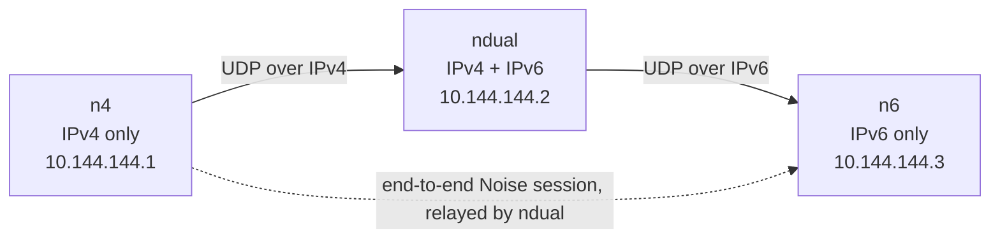

# Skein

[](https://github.com/Utsav-X-bit/Skein/actions/workflows/ci.yml)

Skein is a small userspace mesh VPN for 2–5 of your own machines on Linux and
Windows. It builds an encrypted full mesh over plain UDP and can bridge an
IPv4-only host to an IPv6-only host when a dual-stack member is online.



`ndual` forwards opaque ciphertext: it never holds the `n4 ↔ n6` session keys.

## Features

- **End-to-end `Noise_IKpsk2_25519_ChaChaPoly_BLAKE2s`** between every pair of
  nodes, with explicit nonces, 64-packet replay windows per key epoch, and a
  fresh rekey every hour or 2³² packets.
- **Dual overlay**: IPv4 `10.144.144.0/24` and IPv6 ULA `fd00:6d65:7368::/64`,
  both configurable per node.
- **One UDP port** (default `11010`), dual-stack socket with a paired-socket
  fallback.
- **Discovery**: static peers, `skein:1:…` invite strings, mDNS on the local
  link, and authenticated state gossip carrying overlay addresses, names, and
  self-certifying public keys, so a mesh forms without every pair exchanging
  invites.
- **Bounded routing**: distance vector with full paths, split horizon, and at
  most four links. Relays rewrite only `to_next` and `ttl`.
- **One privileged daemon, one minimal helper** (ADR-001, see
  [`docs/engineering/ADR-001.md`](docs/engineering/ADR-001.md)): `skeind` is
  the service binary and the only privileged actor — it owns the TUN device,
  routes, firewall, sessions, peers, and config (single writer, cross-process
  lock), and serves the control API, including init/join/import, rotate,
  reset, leave, and self-update. `skein` is the unprivileged CLI/TUI and a
  control-API client; it never writes system config directly and never spawns
  a daemon. The desktop GUI is unprivileged always.
- **Desktop control surface**: `skein-desktop` is a Wails app for onboarding,
  peers, invites, activity, diagnostics, settings, firewall repair, and
  service control. It talks to the daemon over a root-owned Unix socket or
  Windows named pipe, never a shell, and verifies the daemon's server
  identity on every dial.
- **Fixed-verb privileged helper**: `skein-helper` keeps only `bootstrap`,
  `install`, `uninstall`, `start`, `stop`, `restart`, `status`,
  `grant-user`, `set-owner` (Windows), and `revoke-user`. Every verb
  validates its inputs and returns one JSON object; secrets travel on stdin or
  a GUI-created pipe, never argv. The removed verbs (`init`, `join`,
  `import`, `rotate-secret`, `reset`, `update-daemon`) exit 1 and print the
  daemon endpoint that replaces them (see [CLI](#cli)).
- **Automatic firewall**: `skein run` opens the underlay port and trusts the
  overlay interface (ufw, firewalld, raw iptables fallback, or Windows
  Firewall), so any protocol works without extra rules. The desktop Security
  page shows the manager, owned rules, and a repair action.
- **Relay introductions**: a peer reachable only through a relay asks it for an
  introduction, both sides dial each other's observed endpoint at once, and a
  failed punch keeps the relayed path.
- **TCP fallback**: every node listens on TCP on the same port; after two
  silent UDP attempts the dialer switches to TCP.
- **Self-maintaining config**: learned peers are written back to the TOML
  atomically, so a restart keeps the mesh.
- **Named nodes**: each node sets `node.name`; names travel in STATE gossip and
  appear in the dashboard, `skein peers`, and the API.
- **Mission-control dashboard**: `skein dashboard` adapts from compact to wide
  terminals, renders only known route paths, and shows per-link throughput,
  transport, RTT, jitter, and authenticated aggregate mesh activity.

Version `0.1.0-dev`.

## Install

Skein ships as five pieces:

| File | Purpose |
|---|---|
| `skeind` | Privileged daemon / system service (the only privileged actor) |
| `skein` | Unprivileged CLI, TUI dashboard, and control-API client (`skein run` is the dev path only) |
| `skein-helper` | Elevated minimal helper used by the desktop (retained verbs only, see above) |
| `skein-desktop` | Wails desktop control surface (unprivileged) |
| `wintun.dll` | Windows tunnel driver (Windows only) |

Packaged installs are the supported path: the Linux package (nfpm) ships
`skeind` at `/usr/local/bin/skeind`, `skein-helper` at
`/usr/libexec/skein-helper`, the `skein` CLI, the systemd unit, the `skein`
group (sysusers), the runtime directory (tmpfiles), and the polkit policy; the
Windows installer (NSIS) ships the desktop, `skeind.exe`, `skein-helper.exe`,
`skein.exe`, and `wintun.dll` into `C:\Program Files\Skein`. See
[Packaging](#packaging) below.

### Linux

**Prerequisites**

- Go 1.26+
- Wails 3 CLI: `go install github.com/wailsapp/wails/v3/cmd/wails3@v3.1.0`
- GTK4 + WebKitGTK 6.0 development packages

```bash
# Arch
sudo pacman -S --needed go gtk4 webkitgtk-6.0

# Debian / Ubuntu
sudo apt install build-essential libgtk-4-dev libwebkitgtk-6.0-dev

# Fedora
sudo dnf install gcc gtk4-devel webkitgtk6.0-devel

export PATH="$PATH:$(go env GOPATH)/bin"
wails3 doctor
```

**Build**

```bash
git clone https://github.com/Utsav-X-bit/Skein && cd Skein
go build -trimpath -o skein ./cmd/skein
go build -trimpath -o skein-helper ./cmd/skein-helper
(cd gui && wails3 build)          # -> gui/bin/skein-desktop
```

**Install (packaged)**

Install the nfpm package for your distro; it places the binaries, unit,
group, tmpfiles entry, and polkit policy above. Then create or join a
network through the desktop, or from a terminal with the system commands
below — the daemon, not the desktop and not the helper, writes the system
config (`/etc/skein/skein.toml`) and identity, as the single writer.

`skein-helper` must stay root-owned at `/usr/libexec/skein-helper`; the
desktop invokes it with `pkexec` (or polkit). After bootstrap, the daemon
grants your uid access to `/run/skein/control.sock` (0660, root:skein).

**Build from source (dev layout)**

```bash
go build -trimpath -o skein ./cmd/skein
go build -trimpath -o skeind ./cmd/skeind
go build -trimpath -o skein-helper ./cmd/skein-helper
(cd gui && wails3 build)          # -> gui/bin/skein-desktop
```

**Service without the desktop**

```bash
# First node: the helper mints a single-use bootstrap token and starts the
# daemon in bootstrap mode; the CLI posts it to the daemon bootstrap endpoint.
sudo skein system init [--name NAME] [--port PORT] [--mtu MTU]
# Joining node:
sudo skein system join "skein:2:…"
# Then: lifecycle via the helper, mesh operations via the daemon API:
sudo skein system start|stop|restart
skein system leave        # leave this node's own network (see Limits)
skein system rotate       # rotate the network secret via the daemon, then helper restart
```

`install-service` (via the minimal helper) opens the underlay UDP port for
IPv4 and IPv6 before the service starts; the overlay interface trust rule is
added when the daemon starts. ufw and firewalld get family-neutral rules;
without either, Skein appends its own iptables rules.

### Windows

**Prerequisites**

- Go 1.26+
- Wails 3 CLI: `go install github.com/wailsapp/wails/v3/cmd/wails3@v3.1.0`
- WebView2 runtime (included with current Windows 10/11)
- Administrator access for the service and firewall rules

**Build** (PowerShell)

```powershell
git clone https://github.com/Utsav-X-bit/Skein
cd Skein
go build -trimpath -o dist\skein.exe        .\cmd\skein
go build -trimpath -o dist\skeind.exe       .\cmd\skeind
go build -trimpath -o dist\skein-helper.exe .\cmd\skein-helper

cd gui
wails3 build          # -> gui\bin\skein-desktop.exe
cd ..

.\scripts\fetch-wintun.cmd -Dest dist
```

`fetch-wintun.cmd` downloads the pinned Wintun release, verifies its SHA-256,
and installs `wintun.dll` plus its license. If scripts are blocked:

```powershell
powershell -NoProfile -ExecutionPolicy Bypass -File .\scripts\fetch-wintun.ps1 -Dest dist
```

Or download <https://www.wintun.net/builds/wintun-0.14.1.zip> manually and copy
`wintun/bin/amd64/wintun.dll` into `dist`.

**Install**

```powershell
$dst = 'C:\Program Files\Skein'
New-Item -ItemType Directory -Force $dst | Out-Null
Copy-Item dist\* $dst -Recurse
Copy-Item gui\bin\skein-desktop.exe $dst
```

The desktop looks for `skein-helper.exe` next to itself first, then at
`C:\Program Files\Skein\skein-helper.exe`, so running the app from `dist`
works when both binaries are there. `wintun.dll` must sit next to `skein.exe`
and `skein-desktop.exe`.

**Service without the desktop**

```powershell
cd 'C:\Program Files\Skein'
# First node / joining node: helper bootstrap token + daemon bootstrap endpoint.
.\skein.exe system init
.\skein.exe system join "skein:2:…"
.\skein.exe system start
sc start skein
```

`install-service` creates the underlay UDP rule immediately; the inbound and
outbound overlay interface rules are created when the daemon starts. The
desktop Security page can repair them.

**Git Bash**

Do not paste the PowerShell commands above into Git Bash: backslashes escape
the next character, so `.\cmd\skein` becomes `.cmd\skein`. Use forward
slashes and install the Wails CLI into `$HOME/go/bin`:

```bash
go install github.com/wailsapp/wails/v3/cmd/wails3@v3.1.0
export PATH="$PATH:$HOME/go/bin"

go build -trimpath -o dist/skein.exe        ./cmd/skein
go build -trimpath -o dist/skeind.exe       ./cmd/skeind
go build -trimpath -o dist/skein-helper.exe ./cmd/skein-helper
(cd gui && wails3 build)                    # -> gui/bin/skein-desktop.exe
./scripts/fetch-wintun.cmd -Dest dist
```

If `wails3` is still not found, run `wails3 doctor` after restarting the shell,
or use the PowerShell wrapper instead:

```powershell
powershell -NoProfile -ExecutionPolicy Bypass -File .\test\windows\build.ps1
```

Use Windows Terminal or `winpty` for the animated TUI; MinTTY gets the static
snapshot.

## Quick start

### Desktop (GUI)

**First node**

1. Launch `skein-desktop` (Linux) or
   `C:\Program Files\Skein\skein-desktop.exe` (Windows).
2. Choose **Create a network**. The defaults are usually enough; set a name if
   you want peers to see it.
3. Approve the UAC/`pkexec` prompt. The helper mints a single-use bootstrap
   token and starts the daemon in bootstrap mode; the daemon writes the
   config and identity as the single writer and then runs normally (see
   [Bootstrap](#bootstrap)).
4. Copy the join string shown by the app.

**Other nodes**

1. Launch the desktop and choose **Join a network**.
2. Paste the join string.
3. Approve the elevation prompt. The node bootstraps, joins, and starts
   automatically.

If `/etc/skein` (Linux) or `C:\ProgramData\Skein` (Windows) already exists
but the service is stopped, choose **Use an existing installation** instead of
creating a new network. The Overview page shows peers and routes; Security
shows the firewall manager and repair action.

### Terminal (TUI)

With the service installed, the TUI attaches over the control socket/pipe; no
`-c` or `sudo` is needed:

```bash
skein dashboard
```

Without a service, run a dev daemon (dev-only; the system path is
`skein system init|join` above):

```bash
skein init                                  # prints a join string
sudo skein run -c ~/.config/skein/skein.toml
# in another terminal:
skein dashboard
```

Join another node with `skein join "skein:2:…"` before starting its daemon.
Dashboard keys: `Tab`/`h`/`l` panels, `j`/`k` or arrows select, `Enter`
inspector, `Space` pause motion, `?` help, `q` quit. `--no-motion` renders a
static snapshot.

## Dashboard

```bash
./skein dashboard
```

With the desktop service installed, the dashboard attaches to
`/run/skein/control.sock` on Linux or `\\.\pipe\skein-control` on Windows;
no `-c` is needed. A stale per-user config no longer hides the service: the
default-path client prefers the system control plane, while an explicit `-c`
still selects a dev daemon.

If no daemon is answering, the dashboard reports that and does not start
one: it never spawns a daemon. Start the service (`skein system start`) or a
dev daemon (`skein run -c …`) first, then run the dashboard. Under `sudo`
the invoking user's config is used.

The full-screen dashboard is a dense, btop-style network console. It uses a
woven Skein infinity mark derived from `Logo.png` and reflows for compact,
standard, wide, and short terminals. Its route map draws direct links and
resolved relay paths; it does not invent peer-to-peer edges. Link motion
appears only for measured local traffic or fresh, authenticated aggregate mesh
activity.

`Tab` (or `h`/`l`) changes panels; arrow keys (or `j`/`k`) select a peer;
`Enter` opens its inspector; `Space` pauses decorative/activity motion; `?`
opens the key reference; and `q` quits. The inspector reports current RX/TX
speed and peak (byte-counter deltas), current/rolling RTT, jitter (the change
between RTT samples), transport, hop/direct status, and freshness.

Mesh activity gossip contains only bounded aggregate byte deltas, link
performance, peer IDs, and route IDs—never packet contents, overlay addresses,
ports, or flow identifiers. Remote samples expire quickly and are labelled as
stale rather than extrapolated. `--no-motion` (or `SKEIN_NO_MOTION=1`) renders
a static snapshot; non-TTY output is always static. Set `SKEIN_ASCII=1` for an
ASCII version of the Skein mark on terminals without reliable Unicode.

## Naming nodes

```bash
./skein name "utsav-laptop"     # show or set this node's name
```

The name is advertised in STATE gossip, so every peer displays it instead of a
peer ID. A peer can also be given a local hint before first contact:

```toml
[[peer]]
id     = "b3f64ecc491aba35"
name   = "yoga"
pubkey = "…"
```

The name a peer advertises about itself always wins over the local hint.

## Configuration

```toml
[node]
overlay_ipv4_prefix = "10.144.144.0/24"
overlay_ipv6_prefix = "fd00:6d65:7368::/64"
overlay_ipv4        = "10.144.144.2"
overlay_ipv6        = "fd00:6d65:7368::2"   # optional; requires mtu >= 1280
listen_port         = 11010
network_secret      = "<32 random bytes, base64url>"
mtu                 = 1280
interface           = "skein0"              # Windows default: Skein
name                = "utsav-laptop"        # optional, shown to peers (default: hostname)
public_addr         = "203.0.113.7:11010"   # optional: only when the external port differs

[api]
socket = "/run/skein/control.sock"          # Linux service; helper-managed
# pipe = "skein-control"                    # Windows service
listen = "127.0.0.1:11011"                  # dev-only loopback listener
token  = "<32 random bytes, base64url>"     # dev-only bearer token

[discovery]
mdns        = true
stun        = true                           # learn and advertise the public IPv4/IPv6
stun_server = "stun.l.google.com:19302"      # optional override
```

The desktop/service config is `/etc/skein/skein.toml` on Linux and
`C:\ProgramData\Skein\skein.toml` on Windows, root/Administrator-owned; the
helper writes `api.socket` or `api.pipe` and disables the dev TCP listener.
`api.listen` + `api.token` are for a user-run dev daemon only. The system
socket is `0660 root-owned` with a per-uid ACL; the Windows pipe DACL grants
SYSTEM, Administrators, and the chosen user.

Unknown keys are rejected. The daemon refuses a config readable by group or
others, and the X25519 key lives in `<config dir>/identity.key` with owner-only
permissions.

Full key-by-key reference: [`docs/protocol.md`](docs/protocol.md#configuration).

## CLI

| Command | Purpose |
|---|---|
| `skein init` | Dev-only: create a user-owned identity, config, network secret, API token |
| `skein run` | Run the daemon (root / Administrator); the service uses `/etc/skein` |
| `skein reset [--purge] [--keep-identity]` | Leave the mesh: back up or remove the config and identity, then re-init or join |
| `skein setup [--remove]` | Allow UDP `listen_port` and all traffic on the overlay interface (ufw, firewalld, iptables, Windows Firewall) |
| `skein install-service` | Register the system service |
| `skein uninstall-service` | Remove the service and its firewall rules |
| `skein genkey` | Print the public key and node ID |
| `skein invite` | Print `skein:1:<base64url>` (identity + addresses, no secret) |
| `skein invite --network` | Print the `skein:2:` join string (contains the secret) |
| `skein join <invite>` | Configure this node from a network invite |
| `skein name [value]` | Show or set this node's name |
| `skein dashboard` | Live TUI; attaches to the service socket/pipe or starts a dev daemon |
| `skein status [--json]` | Overlay addresses, peers, uptime, counters |
| `skein peers [list\|add]` | Manage peers (no removal: a peer leaves itself with `skein system leave`) |
| `skein routes [--json]` | Reachability table |
| `skein probe <peer-id>` | Re-probe candidate endpoints |
| `skein ping <overlay-ip>` | Ping through the overlay |
| `skein version`, `skein -v` | Version plus the commit the binary was built from |

| `skein system init\|join\|import` | Bootstrap a system install (helper token + daemon bootstrap endpoint) |
| `skein system reset [--purge] [--keep-identity]` | Reset via the daemon API (secret role) |
| `skein system leave` | Leave this node's own network (no peer removal: see Limits) |
| `skein system rotate` | Rotate the network secret via the daemon, then helper restart |
| `skein system start\|stop\|restart` | Service lifecycle via the minimal helper |
| `skein install-service`, `skein uninstall-service` | Register/remove the system service via the minimal helper |

`setup`, `install-service`, `uninstall-service`, and `reset` are also available
through `skein-helper` with fixed arguments; the desktop uses the helper so no
shell is involved. Helper verbs (retained only): `bootstrap`, `install`,
`uninstall`, `start`, `stop`, `restart`, `status`, `grant-user`,
`set-owner`, `revoke-user`. Removed helper verbs (`init`, `join`, `import`,
`rotate-secret`, `reset`, `update-daemon`) exit 1 with the daemon endpoint
that replaces them.

## Bootstrap

First configuration of a system install is the one place where no config,
identity, or grant exists yet, so it cannot go through the normal
role-gated API. The mechanism, approved as ADR-001 §4:

1. The minimal helper (elevated via pkexec/UAC/polkit) checks that no system
   config exists, generates 256 bits with `crypto/rand`, and stores only the
   SHA-256 hash — root-owned 0600, with the invoking uid/SID, a 10-minute
   expiry, and the verb it was minted for (`init`, `join`, or `import`).
   It installs and starts the daemon, and returns the plaintext token once
   in stdout JSON to the invoking GUI/CLI. The token is held in memory
   only: never logged, never written to disk in plaintext.
2. The daemon starts in bootstrap mode: control socket/pipe only — no TUN,
   no UDP port, no mDNS, no firewall, not a mesh member. It accepts exactly
   one `POST /api/v1/bootstrap/init|join|import` with the token in the JSON
   body (never in a URL or argv), verified in order: kernel transport
   (bearer/dev-TCP callers get 403 even with a valid token), uid/SID match,
   constant-time hash match, expiry, unused. Five failed attempts burn the
   token.
3. On success the token is marked used atomically before any config work,
   the daemon writes config and identity as the sole writer, grants the
   bootstrap caller the `secret` role, deletes the state file, and switches
   in-process to normal mode. A configured daemon answers
   `POST /api/v1/system/init` with 409, not by re-running bootstrap.

Explicitly rejected: unauthenticated bootstrap from any local uid,
long-lived bootstrap passwords, plaintext tokens on disk, and bearer-token
bootstrap over a dev TCP port.

## Control-plane roles

The daemon authenticates every control-plane caller by kernel transport
(Unix `SO_PEERCRED` uid, Windows pipe SID) and authorises by role from the
access file (`/etc/skein/access` on Linux; the access file on Windows):
`read` (status, peers, routes, logs, diagnostics), `mutate` (config patches,
connection, probes, peer invites, firewall repair, leave), `secret`
(network invites, rotate, reset, update check/apply, grants reload, and the
system init/import endpoints), and `bootstrap` (bootstrap endpoints only,
granted only by the bootstrap flow itself — never from the access file).
Legacy bare uid/SID lines in the access file map to `read`, not `mutate`.
The dev TCP listener (`api.listen` + bearer token) exists only for
non-system dev configs and is refused for the system path; the system
control plane is the single Unix socket (0660, root:skein) or Windows
named pipe, and a bind failure is fatal — the daemon never runs headless
with a dead control plane.

### Global flags

| Flag | Meaning |
|---|---|
| `-c, --config <path>` | Explicit config. Without it, client commands prefer the installed service control plane; otherwise the user config dir is used. |
| `--json` | Machine-readable output for `status`, `peers`, `routes`. |
| `--no-color` | Disable ANSI colour. |
| `--no-motion` | Static dashboard (same as `SKEIN_NO_MOTION=1`). |

### Environment

| Variable | Meaning |
|---|---|
| `SKEIN_NO_MOTION=1` | Render the dashboard as a static snapshot. |
| `SKEIN_ASCII=1` | ASCII Skein mark for terminals without reliable Unicode. |
| `SKEIN_NO_TRAY=1` | Start the desktop without a tray icon (diagnostics). |
| `SKEIN_HELPER` | Override the helper path — honoured only in dev (`-tags skeindev`) builds; release GUI/CLI builds ignore it and all other security variables (`SKEIN_CONTROL_SOCKET`, `SKEIN_CONTROL_PIPE`, `SKEIN_DAEMON_IMAGE`, `SKEIN_HELPER_NO_PKEXEC`). Never ship a skeindev build. |
| `SKEIN_NO_FIREWALL` (daemon) | **Honoured in release builds — operator variable, not dev-gated.** When set (any non-empty value), the daemon skips the firewall `Ensure` step after the TUN device exists. Do not set it on a packaged install except as a deliberate operator override; a follow-up (see `docs/engineering/ADR-001.md`) should give it the same release/dev treatment as the GUI/CLI security variables, so a release daemon ignores it. |
| `SKEIN_STATE_FILE` (daemon) | **Honoured in release builds — operator/test variable, not dev-gated.** Overrides the persisted paused-state path (default `/var/lib/skein/state.json` on Linux, `%ProgramData%\Skein\state.json` on Windows). The daemon's own tests use it to point at a temp file; on a packaged install leave it unset. Same release/dev follow-up as `SKEIN_NO_FIREWALL`. |
| `SKEIN_DEBUG=1` | Per-frame receive/forward/drop diagnostics on the daemon. |
| `SKEIN_TUN_PROBE=1` | Root-only TUN kernel round-trip test. |
| `SKEIN_NETNS_PREFIX` | Namespace prefix used by `test/netns/run.sh`. |

Exit codes: `0` success, `1` runtime or API error, `2` usage error.

## API

The desktop and CLI use the same JSON API over the service control plane:

- **Linux**: `unix:///run/skein/control.sock`, `0660 root-owned` plus a per-uid
  ACL; the daemon authenticates the caller with `SO_PEERCRED`.
- **Windows**: `\\.\pipe\skein-control`, DACL SYSTEM/Administrators/granted
  user; the server impersonates the client and checks the token SID.
- **Dev TCP**: `api.listen` + `Authorization: Bearer <token>`; loopback only,
  browser `Origin` requests rejected, no CORS headers.

Body limit 16 KiB, strict JSON, unknown fields rejected. Mutations are audited
without secrets and rate-limited per caller. Errors use
`{code,message,remediation,details,request_id}`.

| Method | Path |
|---|---|
| `GET` | `/api/v1/capabilities` |
| `GET` | `/api/v1/status` |
| `GET` | `/api/v1/identity` |
| `GET` / `PATCH` | `/api/v1/config` (secrets redacted; patch allowlist) |
| `POST` | `/api/v1/connection` (`connect` / `disconnect`) |
| `GET` / `POST` | `/api/v1/peers` (no peer-removal endpoint: a peer leaves itself, below) |
| `POST` | `/api/v1/peers/{id}/probe` |
| `GET` | `/api/v1/routes` |
| `GET` | `/api/v1/activities` |
| `POST` | `/api/v1/invites/peer`, `/api/v1/invites/network` (network invite: `secret` role) |
| `GET` | `/api/v1/logs?since=&limit=` |
| `GET` | `/api/v1/events` (SSE; `Last-Event-ID` replay) |
| `GET` | `/api/v1/diagnostics` |
| `GET` | `/api/v1/security` |
| `GET` | `/api/v1/firewall` |
| `POST` | `/api/v1/firewall/repair` |
| `POST` | `/api/v1/bootstrap/init\|join\|import` (bootstrap mode only, token in JSON body) |
| `POST` | `/api/v1/system/leave` (`mutate` role; this node's own departure) |
| `POST` | `/api/v1/system/rotate-secret`, `/api/v1/system/reset` (`secret` role) |
| `POST` | `/api/v1/system/init\|join\|import` (configured daemon: init always 409; join/import are the normal-mode counterparts) |
| `GET` / `POST` | `/api/v1/system/update/check`, `/api/v1/system/update/apply` (`secret` role) |
| `POST` | `/api/v1/system/grants/reload` (`secret` role) |

Full contract: [`docs/gui-api.md`](docs/gui-api.md).

## Packaging

- **Linux (nfpm, `gui/build/linux/nfpm/nfpm.yaml`)**: ships `skein-desktop`
  (`/usr/local/bin/skein-desktop`), `skeind` (`/usr/local/bin/skeind`),
  `skein-helper` (`/usr/libexec/skein-helper`), `skein`
  (`/usr/local/bin/skein`), the systemd unit
  (`/usr/lib/systemd/system/skein.service`, `ExecStart=/usr/local/bin/skeind
  run -c /etc/skein/skein.toml`), the `skein` group (sysusers, `g skein -`),
  the runtime directory (tmpfiles, `/run/skein 0750 root skein`), and the
  polkit policy (`/usr/share/polkit-1/actions/org.skein.helper.policy`).
  The unit and the shipped template agree on `ExecStart`; upgrades adopt the
  new binary through `RegisterDaemon` without rewriting the unit, and
  `<binary>.old` plus a timestamped config backup are kept on every upgrade.
  Uninstall never purges config by default (Linux keeps `/etc/skein` and
  `/var/lib/skein/backups`); purge is the daemon reset endpoint, not the
  helper.
- **Windows (NSIS, `gui/build/windows/nsis/project.nsi`)**: ships the
  desktop, `skeind.exe`, `skein-helper.exe`, `skein.exe`, `wintun.dll`, and
  the Wintun licence into `C:\Program Files\Skein`. The build fails if any
  required binary is missing. Uninstall runs the helper's `uninstall` verb
  first (stop-then-delete) and aborts without deleting anything if the
  helper fails, so no orphaned service is left behind; purge moves
  `%ProgramData%\Skein` to `.bak` instead of deleting it.
- **Wintun**: version 0.14.1, SHA-256-pinned in `scripts/fetch-wintun.sh`
  (`.ps1`/`.cmd` wrappers for Windows). The packaged NSIS install places the
  DLL in the admin-only install directory; a portable/zip layout in a
  user-writable directory is not a blessed install (see the M9 checklist in
  `docs/engineering/M9-ACCEPTANCE.md`).
- **Self-update**: operator-driven, never automatic. The operator stages a
  signed manifest (ed25519 + SHA-256, `key_id` + signed `valid_until`,
  basename-only binary under the staging directory); the daemon's
  `GET /api/v1/system/update/check` verifies it and refuses downgrades (the
  new version must be strictly greater — a genuine downgrade is a package
  reinstall, not an update), and `POST /api/v1/system/update/apply`
  launches a detached apply process with verified rollback: on failure the
  previous binary and config are restored and the `.old`/config backups are
  never deleted. The GUI About/Updates screen drives check/apply; there is
  no version-feed endpoint and no automatic check.
- Content assertions: `scripts/packaging-assert.sh` parses both manifests
  and fails if a shipped file, the install directory, the uninstall order,
  or the purge behaviour drifts; `scripts/collapse-gates.sh` enforces the
  collapse invariants (single writer, no daemon spawn from GUI/CLI, no
  removed helper verb called from GUI/CLI, no removed endpoint, no secret
  logging). Both run in CI.

## Firewall and any protocol

`skein run` opens what it needs at startup, idempotently:

- **Linux** — with `ufw` active it allows `<port>/udp`, all traffic on the
  overlay interface, and the matching route rules; with `firewalld` it adds the
  port and puts the interface in the trusted zone; otherwise it appends
  `INPUT`/`OUTPUT`/`FORWARD` accepts for the interface and underlay port.
- **Windows** — it creates `Skein underlay` (inbound UDP on the port),
  `Skein overlay` (all inbound traffic on the interface), and `Skein overlay
  out` (all outbound traffic on the interface) firewall rules.

The desktop Security page reports the detected manager, the owned rule set,
config/identity ownership and modes, socket ACL, update signature, and a
**Repair rules** action. “5 managed” is the expected set, not a live audit of
every kernel rule. A systemd sandbox must allow `/run/ufw.lock` for `ufw status`
to work; the shipped unit does.

Because the overlay interface is trusted, every protocol works without
per-service rules:

```bash
ssh user@10.144.144.2
python3 -m http.server 8000 --bind 10.144.144.1
```

The only underlay requirement is that **one side of each pair is reachable** on
the UDP port: a public IPv4 with a forward, a public IPv6, or the same LAN.
SSH and every other protocol travel inside the tunnel and never need their own
router forward.

## Reliability

- Keepalive every 15 s keeps NAT mappings open.
- 45 s without authenticated traffic marks the peer down, clears the cached
  endpoint, drops the session, and withdraws its routes; a configured dialer
  re-handshakes immediately instead of encrypting for a dead address.
- Handshake retries back off 1 s → 30 s and reset as soon as a route appears.
- A changed endpoint is only adopted after a challenge/response over the
  existing session.
- When a path dies, the session is dropped and the dialer retries UDP, then TCP
  on the same port, then the relayed route.

## Reaching peers behind NAT

One side of every pair must be reachable, or introduced by a relay:

- **Direct** — a public IPv4 with a UDP forward, a public IPv6, or the same LAN.
  A node probes a STUN server over both families (`discovery.stun`) and
  advertises the public IPv4 and IPv6 next to its LAN addresses, so joiners
  dial the right place without editing configs. Set `node.public_addr` when
  the external port differs from `listen_port`, or `stun = false` to disable
  the probes (the `SKEIN_NO_STUN` environment variable does the same).
- **Relayed** — both sides connect to any reachable peer (a cheap VPS is
  enough); it forwards opaque ciphertext.
- **Introductions** — a node that only reaches a peer through a relay asks the
  relay, which reports both observed endpoints; both sides dial at once. This
  works for endpoint-independent NAT; symmetric NAT keeps the relayed path.
- **UDP blocked** — after two silent UDP attempts the dialer opens TCP to the
  same port, and TCP frames are written in one syscall with Nagle disabled so
  the fallback does not collapse under delayed ACKs. A datagram from the peer
  clears the preference again, so a working UDP path always wins. Set
  `listen_port = 443` to make both transports use 443.

### Examples

| A | B | C | Result |
|---|---|---|---|
| CGNAT v4 + public v6 | CGNAT v4 + public v6 | public v4 | A↔B **direct over IPv6**; A↔C and B↔C direct if C has IPv6, otherwise relayed through whichever node does |
| CGNAT v4 + public v6 | public v4 + public v6 | CGNAT v4 | A↔B direct over IPv6; C dials B over IPv4; A↔C relayed through B |
| CGNAT v4 + public v6 | public v4 + public v6 | CGNAT v4 + no v6 | same, with C dialing B and B forwarding |

Candidates include every interface address (v4 and v6), so the dialer tries
IPv6 first when it works; the route table then keeps the cheapest validated
path. IPv6 needs UDP `<port>` open on the listener's host firewall, which the
daemon configures automatically.

Not implemented: TLS camouflage and a global DERP-style relay network. STUN
is implemented (`discovery.stun`); the probes learn the public IPv4/IPv6.

## How it works

```
[type:1][to_next:8][to_final:8][from:8][ttl:1] payload
```

The 26-byte header is authenticated as AEAD associated data except the
relay-mutable `to_next` and `ttl`. Encrypted frames add `[epoch:4][counter:8]`
and a 16-byte tag, so a 1280-byte inner packet becomes **1382 bytes over IPv6**
or **1362 bytes over IPv4** — 54 bytes of protocol overhead.

Handshakes are Noise IKpsk2 with a 128-bit attempt ID and the epoch bound into
the prologue. A session is installed only after an encrypted confirmation; at
one epoch the smaller attempt ID wins, and higher epochs always supersede.
Relays forward both handshake messages and opaque data.

Peer down after 45 s of silence, keepalive every 15 s, state sync every 5 s,
handshake backoff 1→30 s.

## Limits

- Two symmetric-NAT peers still need a reachable relay peer; there is no
  global relay network.
- The TCP fallback is plain TCP, not TLS; it defeats UDP blocking but not
  deep-packet inspection.
- IPv4-only ↔ IPv6-only needs a dual-stack member; no common family, no path.
- More than five nodes or routes longer than four links are unsupported.
- No PMTUD or fragmentation; a dual-stack underlay path below 1382 bytes of
  PMTU is unsupported.
- One shared secret, no per-peer revocation. The join string contains
  that secret, so anyone holding it can join the network. There is no
  "remove this other peer": every peer is equal, anyone can invite, and a
  peer leaves itself (`skein system leave`) and gossips a tombstone so other
  peers withdraw its routes (see [How it works](#how-it-works) and
  `docs/protocol.md`). Leaving is graceful departure, not a ban — the leaver
  keeps its credential until a network-wide secret rotation, and rejoining
  needs a fresh invite. Rotation evicts only after the service restarts and
  every legitimate node rejoins with the new secret.
- The control API authenticates the caller by kernel transport and
  authorises by role (see [Control-plane roles](#control-plane-roles)); a
  process running as a granted uid can use only its role's endpoints.
  Relays can observe peer IDs, sizes, and timing.

## Testing

```bash
go test -race ./...
(cd gui && wails3 build)                            # desktop compile
sudo -E env "PATH=$PATH" ./test/netns/run.sh        # v4-only ↔ v6-only bridge
SKEIN_TUN_PROBE=1 sudo -E env "PATH=$PATH" \
  go test ./internal/tun -run TestTUNWriteRead -v    # TUN kernel round-trip
```

TUI smoke: `skein dashboard` with the service running should attach over the
socket/pipe and quit with `q`. Windows: build with
`test/windows/build.ps1`, then run `test/windows/run-all.ps1 -Bin .\dist`
from an elevated PowerShell (see [`test/windows/README.md`](test/windows/README.md)).

## Docs

- [`docs/protocol.md`](docs/protocol.md) — wire format, handshake, routing,
  discovery, configuration.
- [`docs/measurements.md`](docs/measurements.md) — what was measured and how to
  reproduce it.
- [`docs/gui-api.md`](docs/gui-api.md) — desktop/daemon API contract.
- [`docs/superpowers/specs/`](docs/superpowers/specs) — design spec.
- [`docs/superpowers/plans/`](docs/superpowers/plans) — implementation plan.

## Layout

```
cmd/skein                 daemon, TUI dashboard, and CLI in one binary
cmd/skeind                thin daemon wrapper
cmd/skein-helper          fixed-verb elevated helper for the desktop
gui/                      Wails desktop app, services, frontend, packaging
internal/identity         X25519 keys, peer IDs, invites
internal/conf             TOML schema, defaults, validation
internal/wire             bounded frame codec
internal/session          Noise handshakes, epochs, replay windows
internal/link             UDP transport
internal/tun, internal/netcfg   TUN creation, addresses, routes, MTU
internal/peer, internal/path    peer table, candidate probing
internal/route            bounded distance-vector routing
internal/discovery        mDNS and authenticated state gossip
internal/dataplane        packet plane, forwarding, counters
internal/control          keepalive, state sync, rekey, probes
internal/api, internal/daemon   loopback API and composition
internal/app              daemon entry points shared by both binaries
internal/cli              CLI, API client, and dashboard
internal/firewall         automatic ufw/firewalld/iptables/Windows rules
internal/service          systemd and Windows service installation
internal/pipeconn         Windows named-pipe transport
internal/activity         bounded authenticated mesh telemetry
test/netns, test/windows  runtime harnesses
docs/gui-api.md           desktop/daemon API contract
```

~CheckPoint-1
