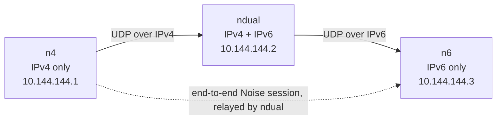

# Skein

[](https://github.com/Utsav-X-bit/Skein/actions/workflows/ci.yml)

Skein is a small userspace mesh VPN for 2–5 of your own machines on Linux and
Windows. It builds an encrypted full mesh over plain UDP and can bridge an
IPv4-only host to an IPv6-only host when a dual-stack member is online.



`ndual` forwards opaque ciphertext: it never holds the `n4 ↔ n6` session keys.

## Features

- **End-to-end `Noise_IKpsk2_25519_ChaChaPoly_BLAKE2s`** between every pair of
  nodes, with explicit nonces, 64-packet replay windows per key epoch, and a
  fresh rekey every hour or 2³² packets.
- **Dual overlay**: IPv4 `10.144.144.0/24` and IPv6 ULA `fd00:6d65:7368::/64`,
  both configurable per node.
- **One UDP port** (default `11010`), dual-stack socket with a paired-socket
  fallback.
- **Discovery**: static peers, `skein:1:…` invite strings, mDNS on the local
  link, and authenticated state gossip that carries overlay addresses and
  routes (never keys).
- **Bounded routing**: distance vector with full paths, split horizon, and at
  most four links. Relays rewrite only `to_next` and `ttl`.
- **Daemon + CLI**: `skeind` owns the dataplane and a loopback REST/SSE API;
  `skein` is a thin client.

## Status

| Area | Verified |
|---|---|
| Unit tests, `-race`, fuzz target | pass |
| Loopback UDP handshake + overlay packet | pass |
| Three-node Linux netns bridge (v4-only ↔ v6-only) | pass |
| mDNS discovery across a veth | pass (2 s to `up`) |
| systemd install / start / stop / uninstall | pass |
| TUN kernel round-trip | pass |
| Windows | cross-compiles; runtime smoke script provided, not yet run in a VM |

Version `0.1.0-dev`.

## Build

```bash
go build ./cmd/skeind ./cmd/skein
```

Windows (put `wintun.dll` next to `skeind.exe`):

```bash
GOOS=windows GOARCH=amd64 go build ./cmd/skeind ./cmd/skein
```

## Quick start

On every machine (no privileges needed for these two):

```bash
./skein init      # identity, config, network secret, API token
./skein invite    # share this string with the other nodes
```

`init` writes `~/.config/skein/skein.toml` and `identity.key`
(`%APPDATA%\skein\` on Windows). Give every node the **same
`network_secret`** and a **unique `overlay_ipv4`**, then either rely on mDNS on
the same LAN or add peers:

```toml
[[peer]]
id     = "b3f64ecc491aba35"
pubkey = "K2Ipr1k0juOQxvsbrOFvFo2vMupEJjP78aIA1VytR2U="
dialer = true                      # exactly one side of each pair
addrs  = ["udp://203.0.113.5:11010"]
```

Start the daemon as root/Administrator and check it as your normal user:

```bash
sudo ./skeind run -c ~/.config/skein/skein.toml     # the shell expands ~ first
./skein status
./skein peers list
./skein routes
./skein ping 10.144.144.2
```

Service mode:

```bash
sudo ./skeind install-service -c ~/.config/skein/skein.toml   # systemd / Windows SCM
```

## Configuration

```toml
[node]
overlay_ipv4_prefix = "10.144.144.0/24"
overlay_ipv6_prefix = "fd00:6d65:7368::/64"
overlay_ipv4        = "10.144.144.2"
overlay_ipv6        = "fd00:6d65:7368::2"   # optional; requires mtu >= 1280
listen_port         = 11010
network_secret      = "<32 random bytes, base64url>"
mtu                 = 1280
interface           = "skein0"              # Windows default: Skein

[api]
listen = "127.0.0.1:11011"                  # loopback only
token  = "<32 random bytes, base64url>"

[discovery]
mdns = true
```

Unknown keys are rejected. The daemon refuses a config readable by group or
others, and the X25519 key lives in `<config dir>/identity.key` with owner-only
permissions.

Full key-by-key reference: [`docs/protocol.md`](docs/protocol.md#configuration).

## CLI

| Command | Purpose |
|---|---|
| `skein init` | Create identity, config, network secret, API token |
| `skein genkey` | Print the public key and node ID |
| `skein invite` | Print `skein:1:<base64url>` for this node |
| `skein status [--json]` | Overlay addresses, peers, uptime, counters |
| `skein peers [list\|add\|rm]` | Manage peers |
| `skein routes [--json]` | Reachability table |
| `skein probe <peer-id>` | Re-probe candidate endpoints |
| `skein ping <overlay-ip>` | Ping through the overlay |
| `skein version` | Version |

Global flags: `-c/--config <path>`, `--json`.

## API

Loopback only, `Authorization: Bearer <token from config>`; browser `Origin`
requests are rejected and no CORS headers are sent.

| Method | Path |
|---|---|
| `GET` | `/api/v1/status` |
| `GET` / `POST` | `/api/v1/peers` |
| `DELETE` | `/api/v1/peers/{id}` |
| `POST` | `/api/v1/peers/{id}/probe` |
| `GET` | `/api/v1/routes` |
| `GET` | `/api/v1/config` (secrets redacted) |
| `GET` | `/api/v1/events` (SSE) |

## How it works

```
[type:1][to_next:8][to_final:8][from:8][ttl:1] payload
```

The 26-byte header is authenticated as AEAD associated data except the
relay-mutable `to_next` and `ttl`. Encrypted frames add `[epoch:4][counter:8]`
and a 16-byte tag, so a 1280-byte inner packet becomes **1382 bytes over IPv6**
or **1362 bytes over IPv4** — 54 bytes of protocol overhead.

Handshakes are Noise IKpsk2 with a 128-bit attempt ID and the epoch bound into
the prologue. A session is installed only after an encrypted confirmation; at
one epoch the smaller attempt ID wins, and higher epochs always supersede.
Relays forward both handshake messages and opaque data.

Peer down after 45 s of silence, keepalive every 15 s, state sync every 5 s,
handshake backoff 1→30 s.

## Limits

- No relay service, STUN, hole punching, or TCP/WSS: CGNAT-to-CGNAT and
  UDP-blocked networks cannot connect.
- IPv4-only ↔ IPv6-only needs a dual-stack member; no common family, no path.
- More than five nodes or routes longer than four links are unsupported.
- No PMTUD or fragmentation; a dual-stack underlay path below 1382 bytes of
  PMTU is unsupported.
- One shared secret, no per-peer ACLs or revocation.
- The loopback API is not an isolation boundary between processes of the same
  user, and relays can observe peer IDs, sizes, and timing.

## Testing

```bash
go test -race ./...
sudo -E env "PATH=$PATH" ./test/netns/run.sh        # v4-only ↔ v6-only bridge
SKEIN_TUN_PROBE=1 sudo -E env "PATH=$PATH" \
  go test ./internal/tun -run TestTUNWriteRead -v    # TUN kernel round-trip
```

Windows runtime check: `test/windows/smoke.ps1` (elevated, with `wintun.dll`).

## Docs

- [`docs/protocol.md`](docs/protocol.md) — wire format, handshake, routing,
  discovery, configuration.
- [`docs/measurements.md`](docs/measurements.md) — what was measured and how to
  reproduce it.
- [`docs/superpowers/specs/`](docs/superpowers/specs) — design spec.
- [`docs/superpowers/plans/`](docs/superpowers/plans) — implementation plan.

## Layout

```
cmd/skeind, cmd/skein     daemon and CLI entry points
internal/identity         X25519 keys, peer IDs, invites
internal/conf             TOML schema, defaults, validation
internal/wire             bounded frame codec
internal/session          Noise handshakes, epochs, replay windows
internal/link             UDP transport
internal/tun, internal/netcfg   TUN creation, addresses, routes, MTU
internal/peer, internal/path    peer table, candidate probing
internal/route            bounded distance-vector routing
internal/discovery        mDNS and authenticated state gossip
internal/dataplane        packet plane, forwarding, counters
internal/control          keepalive, state sync, rekey, probes
internal/api, internal/daemon   loopback API and composition
internal/cli              CLI and API client
internal/service          systemd and Windows service installation
test/netns, test/windows  runtime harnesses
```
